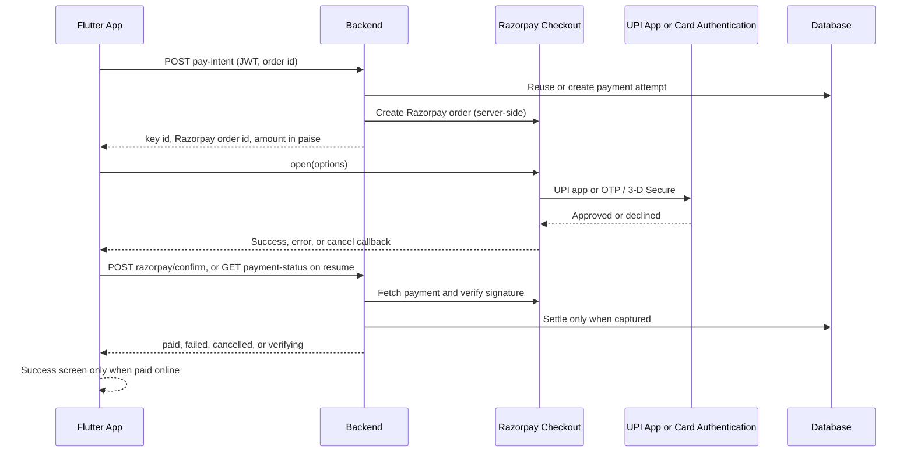

# Flutter Razorpay Checkout

Customer payments use the existing `razorpay_flutter` 1.4.7 Checkout. The app does not build its own UPI links and does not collect card numbers, CVV, or OTP. The amount and the paid/failed result come from the backend.

Installed SDK: `razorpay_flutter` `^1.4.0`, resolved to `1.4.7` in `customer-app/pubspec.lock`.

## A. Existing functionality

This was already in place before the checkout gaps below were closed.

- `customer-app/pubspec.yaml` depends on `razorpay_flutter`. The key secret is not in the app. Checkout receives the public key id from `POST /api/v1/payments/orders/:orderId/pay-intent`.
- Both bill screens register `EVENT_PAYMENT_SUCCESS`, `EVENT_PAYMENT_ERROR`, and `EVENT_EXTERNAL_WALLET`.
- Success calls `POST /api/v1/payments/orders/:orderId/razorpay/confirm` with the order id, payment id, and signature returned by Checkout. The success screen opens only when the backend says the payment is captured online (`isPaidOnline`).
- Cancel (Razorpay code `2`) calls `POST /api/v1/payments/orders/:orderId/cancel-attempt`, then reads the server status before showing success.
- `GET /api/v1/payments/orders/:orderId/payment-status` runs when an existing bill screen opens and when the app resumes.
- Listeners are removed with `Razorpay.clear()` in `dispose`, not when the app is paused.
- `processPayment` does not call the deprecated HTTP 410 route.
- Cash on the order payment screen does not mark the bill paid.
- Android `MainActivity` extends `FlutterActivity`, which matches the 1.4.7 example. Checkout is a separate `CheckoutActivity` started for a result, so the customer returns to Flutter after UPI or card authentication.
- `minSdk` was already the Flutter default, which is above the SDK floor of 19. iOS deployment target is 13.0, above the SDK floor of 10.0. Release builds do not minify, so the SDK ProGuard keep rules are not required yet.

What was missing:

- Android 11+ could not see installed UPI apps, because the manifest only queried text, https, mailto, and tel.
- iOS `LSApplicationQueriesSchemes` did not include the UPI schemes Checkout uses for `canOpenURL`.
- The payment screen could open a second Checkout if Pay was tapped again. The order screen turned the button back on as soon as `open()` was invoked, because that call does not wait for the customer to finish paying.
- There was no Refresh status control while verification was unfinished.
- A timeout and a real decline shared one path, and the button could be used again before the server had been checked.

Razorpay Dashboard, not code:

- UPI and cards must be enabled on the merchant account. Checkout only offers methods the account allows. This app does not decide which UPI apps exist on a phone.
- The webhook URL `POST /api/v1/payments/webhook/razorpay` and `RAZORPAY_WEBHOOK_SECRET` are still required for recovery when the app never receives the SDK callback. The app does not set those.

## B. Changes made

| File | Change |
| --- | --- |
| `customer-app/lib/services/checkout_session.dart` | Checkout phase: Pay Now, Opening Checkout, Awaiting payment, Verifying payment, success, failure, cancellation, unknown, refund pending, refund completed, already paid. A second Checkout is blocked while opening, awaiting, verifying, or unknown. Pausing does not change the phase. |
| `customer-app/lib/screens/payment/payment_screen.dart` | Existing-bill Pay uses that session, stays disabled through Checkout, confirms only after the SDK success event, and shows Refresh status. |
| `customer-app/lib/screens/orders/order_payment_screen.dart` | Same session. The button no longer re-enables when Checkout has only just opened. |
| `customer-app/android/app/src/main/AndroidManifest.xml` | UPI `VIEW` intent plus the package names Android 11 hides from Checkout: Google Pay, PhonePe, Paytm, BHIM. |
| `customer-app/android/app/build.gradle.kts` | `minSdk` is at least 21. |
| `customer-app/ios/Runner/Info.plist` | Query schemes `tez`, `phonepe`, `paytmmp`, `credpay`, `bhim`, `amazonpay`. |
| `customer-app/test/checkout_session_test.dart` | Twelve mocked cases. |

Backend settlement, webhooks, reconciliation, cash, and refunds were not changed.

## C. Customer payment flow

### UPI

1. The customer opens an order whose bill is still pending and taps Pay.
2. Flutter calls pay-intent. The backend creates or reuses the Razorpay order and returns the public key, order id, and amount in paise.
3. Flutter opens Razorpay Checkout with that order. The options do not force a method.
4. The customer picks UPI inside Checkout. Installed apps appear when the phone and the Razorpay account support them.
5. Checkout opens the selected app. Flutter only records "Awaiting payment". Pause is not treated as cancel, and the Razorpay listeners stay registered.
6. After approval or decline, Checkout returns to Flutter and emits success or error.
7. Success calls confirm. The backend checks the signature, payment id, order id, amount, and captured status.
8. The success screen is shown only after that confirm result says the online payment is captured.

### Card

1. The customer picks debit or credit card inside the same Checkout.
2. Razorpay collects the card and runs OTP or 3-D Secure. Flutter never sees the card number, CVV, or OTP.
3. The same success or error callback runs.
4. Confirm performs the same server checks. Success is shown only after capture.

### Cancellation

Checkout error code `2` calls cancel-attempt. If the server still says pending, verifying, or unknown, the app shows the verification sentence and blocks another Pay until Refresh status. If the server says the attempt was cancelled, the banner says "Payment cancelled" and the bill stays unpaid. If the server says it was captured, the success screen opens.

### Failure

Any other Checkout error keeps the session unknown, shows the SDK message when it has one, and immediately fetches payment status. The server result replaces that message with "Payment failed", "Payment successful", or the verification sentence. Pay stays disabled until that fetch finishes. A failed status may be retried. Pay-intent then follows the existing backend retry and idempotency rules.

### App switch and return

`inactive` and `paused` call `pausedForExternalApp()`, which does not dispose Razorpay and does not cancel. `resumed` fetches payment status. A still-pending attempt that was awaiting Checkout stays on "Awaiting payment" so a second window is not opened. A captured payment opens success even when the SDK callback never arrived.

### Successful backend verification

Confirm or payment-status returns `verificationState: paid` with a non-cash completed payment. `CheckoutSession` moves to "Payment successful", and the screen navigates to the existing success page. Refund pending and refund completed stay on the payment screen with those labels, including when the bill is still completed because of an earlier cash collection.

## D. Important code snippets

Razorpay is created once and cleared only when the screen is disposed.

```dart
_razorpay = Razorpay();
_razorpay.on(Razorpay.EVENT_PAYMENT_SUCCESS, _onRazorpaySuccess);
_razorpay.on(Razorpay.EVENT_PAYMENT_ERROR, _onRazorpayError);
_razorpay.on(Razorpay.EVENT_EXTERNAL_WALLET, _onRazorpayWallet);
```

```dart
void dispose() {
  WidgetsBinding.instance.removeObserver(this);
  _razorpay.clear();
  super.dispose();
}
```

Checkout options come from the pay-intent payload. There is no client amount and no method lock.

```dart
Map<String, dynamic> toOptions() {
  return {
    'key': key,
    'amount': amount,
    'currency': currency,
    'name': 'Laundry',
    'description': 'Bill payment',
    'order_id': orderId,
  };
}
```

Opening Checkout:

```dart
if (!_checkout.begin()) {
  _setNotice(_checkout.message);
  return;
}
final intent = await PaymentRepository().createPayIntent(orderId: orderId);
final launch = launchFromIntent(intent);
_checkout.awaitingExternalApp();
_razorpay.open(launch.toOptions());
```

Success callback:

```dart
_checkout.verifying();
final result = await PaymentRepository().confirmRazorpay(
  orderId: orderId,
  razorpayOrderId: response.orderId ?? '',
  razorpayPaymentId: response.paymentId ?? '',
  razorpaySignature: response.signature ?? '',
);
_checkout.applyServerResult(result);
if (!result.isPaidOnline) {
  _checkout.unknown(paymentVerificationMessage);
  return;
}
_openPaid(result);
```

Failure and cancel:

```dart
if (response.code == Razorpay.PAYMENT_CANCELLED) {
  final result = await PaymentRepository().cancelAttempt(orderId: orderId);
  _checkout.applyServerResult(result);
  if (result.verificationState == 'pending' ||
      result.verificationState == 'verifying' ||
      result.verificationState == 'unknown') {
    _checkout.unknown(paymentVerificationMessage);
  } else if (_checkout.phase == CheckoutPhase.idle || _checkout.phase == CheckoutPhase.awaiting) {
    _checkout.cancelled();
  }
  return;
}
_checkout.unknown(sdkMessage.isEmpty ? paymentVerificationMessage : sdkMessage);
await _refreshPaymentStatus(navigateOnPaid: true);
```

The verification sentence, used for timeouts and an unfinished status:

```dart
const paymentVerificationMessage =
    "Your payment is being verified. Please don't pay again until we confirm its status.";
```

Resume refreshes status. Pause does not cancel.

```dart
void didChangeAppLifecycleState(AppLifecycleState state) {
  if (state == AppLifecycleState.inactive || state == AppLifecycleState.paused) {
    _checkout.pausedForExternalApp();
    return;
  }
  if (state == AppLifecycleState.resumed) {
    _refreshPaymentStatus(navigateOnPaid: true);
  }
}
```

```dart
void pausedForExternalApp() {}
```

## E. Configuration

### Android

- `minSdk` is `maxOf(flutter.minSdkVersion, 21)`. The plugin requires at least 19.
- `launchMode` is `singleTop`. Checkout returns through `startActivityForResult`.
- The main manifest `<queries>` block includes the UPI pay intent and these packages so Android 11 and newer let Checkout see them: `com.google.android.apps.nbu.paisa.user`, `com.phonepe.app`, `net.one97.paytm`, `in.org.npci.upiapp`.
- ProGuard keep rules from the plugin README are not added. The release build does not minify. Add them before enabling minify.
- No extra permissions were added.

### iOS

- Deployment target is 13.0. The plugin requires 10.0.
- `LSApplicationQueriesSchemes` now includes `tez`, `phonepe`, `paytmmp`, `credpay`, `bhim`, and `amazonpay`, in addition to the existing `whatsapp`, `mailto`, `tel`, and `https`. These let Checkout ask whether an app is installed. The app does not open them itself.
- UPI app handoff on iOS still depends on the Razorpay iOS Checkout SDK and on which apps are installed. Cards and 3-D Secure stay inside Checkout.

### Razorpay Dashboard

- Test or live key id and secret stay in backend environment variables. Only the key id is returned to Flutter.
- Enable UPI and card methods for the account. A method that is disabled will not appear, even with the manifest changes.
- Set the webhook to `POST /api/v1/payments/webhook/razorpay` and put the signing secret in `RAZORPAY_WEBHOOK_SECRET`. That path recovers a captured payment when the phone never delivers the SDK callback. Reconciliation also reads the order from Razorpay. Neither starts a new charge.

## F. Testing

Automated, from `customer-app`:

`flutter test test/checkout_session_test.dart` — 12 passed.

| Case | Result |
| --- | --- |
| Pay-intent payload becomes Checkout options | Passed. Amount is the server paise value. No `method` key. |
| Checkout is not built without a Razorpay order id | Passed |
| Success only after captured server status | Passed |
| Failed server status | Passed |
| Cancellation leaves the session unpaid and allows another attempt | Passed |
| Second `begin()` is rejected while opening or awaiting | Passed |
| Pause does not cancel an awaiting payment | Passed |
| Confirm timeout uses the verification sentence and blocks Pay until a pending status is fetched | Passed |
| Resume with a captured status after a missing callback | Passed |
| Cold start on a pending attempt does not open Checkout | Passed |
| Already paid does not build a launch | Passed |
| Refund pending and refund completed are separate labels | Passed |

`flutter analyze` on `checkout_session.dart`, `payment_service.dart`, `payment_screen.dart`, and `order_payment_screen.dart` reported 14 info-level items already in `payment_screen.dart` (build-context, `indexOf`, `withOpacity`, const). No errors or warnings were reported in the new checkout code.

Not verified:

- No real UPI payment was made.
- No real card payment, OTP, or 3-D Secure challenge was made.
- No refund was sent to Razorpay.
- Native return from Google Pay, PhonePe, or Paytm was not run on a device.
- iOS `canOpenURL` behavior was not run on a device.

### Manual checklist

Use a Razorpay **test** key. Do not use a live card.

Android:

1. Open an order with a pending bill. Tap Pay once. Checkout opens and the button reads "Awaiting payment".
2. Tap Pay again. A second Checkout must not open.
3. Choose UPI. Confirm Google Pay, PhonePe, or Paytm appears only if that app is installed and the method is enabled.
4. Approve in the UPI app. The laundry app must return, then show success only after the bill is paid on the server.
5. Decline or cancel. The bill must stay unpaid. Pay must stay disabled until Refresh status or a terminal status.
6. Kill the app after UPI approval but before the success screen. Reopen the order. The screen must match the server status and must not charge again.
7. Turn the network off during confirm. The verification sentence and Refresh status must appear. Do not pay again until refresh says failed or pending.

iOS:

1. Repeat the Pay, cancel, and card paths. Card OTP stays inside Checkout.
2. UPI apps appear only when iOS and the installed Razorpay SDK can open them. Do not expect every Android UPI app to appear.

Card, either platform:

1. In test mode use Razorpay's documented test card `4111 1111 1111 1111`, any future expiry, any CVV, and OTP `1234` if the test bank asks.
2. Confirm the Flutter logs and backend logs do not contain the card number, CVV, or OTP.

## G. Sequence


