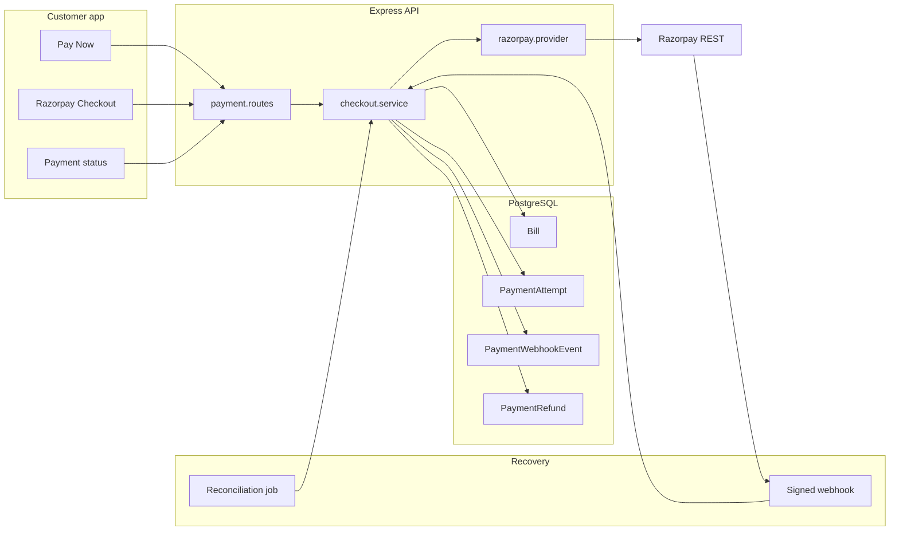
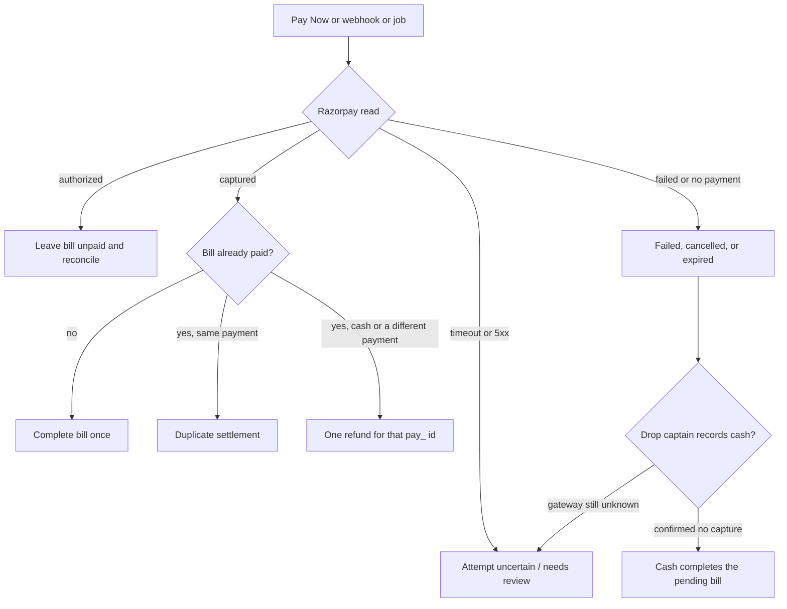
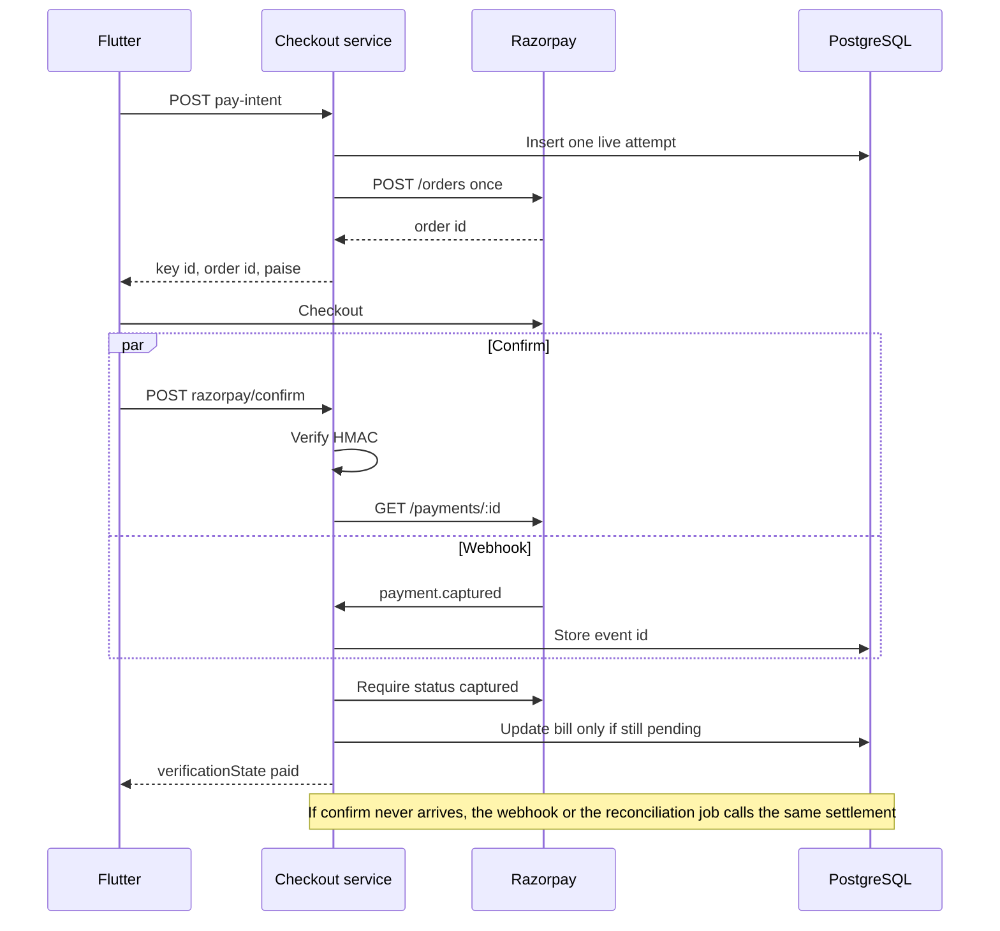

# Payment implementation summary

This describes the Razorpay flow that is in the code now. Amounts and payment status come from Razorpay. Flutter cannot mark a bill paid.

## Architecture



The bill is still created in `door.service` when the pickup captain confirms the door count. Payment does not change the order status. Delivery still requires `bill.payment_status = completed`, the drop photo, and the assigned drop captain.

`checkout.service` is the only writer that marks a bill paid. Online settlement and cash settlement both use `bill.updateMany` where `payment_status = pending`, so only one of them can win.

## Payment flow

1. Pickup captain confirms the items. The backend writes the bill with `payment_status = pending`.
2. The customer taps Pay Now. `POST /api/v1/payments/orders/:orderId/pay-intent` checks the order is payable and the bill is unpaid.
3. The backend creates one `PaymentAttempt` and one Razorpay order (`payment_capture: 1`). The amount is `bill.final_amount` in paise. Flutter's amount is not used.
4. Flutter opens Razorpay Checkout with the key id, Razorpay order id, and paise from that response.
5. On success, Flutter calls `POST /api/v1/payments/orders/:orderId/razorpay/confirm` with the checkout ids and signature.
6. The backend checks the HMAC with `RAZORPAY_KEY_SECRET`, then `GET /v1/payments/:id`.
7. The bill is completed only when Razorpay reports `captured`, the payment belongs to that Razorpay order, and the paise match the attempt. `authorized` does not complete the bill.
8. Bill and attempt update in one Prisma transaction. `payment_received` is emitted only when that transaction is the one that flips the bill from pending to completed.
9. Flutter reads `verificationState`. It opens the success screen only when the backend says the online payment completed.

## Fallback behavior

| Situation | What the code does |
| --- | --- |
| Razorpay captured the payment and Flutter never called confirm | `payment.captured` or `order.paid` settles through the same function. The reconciliation job also fetches `GET /orders/:id/payments` and settles a captured payment. It never creates a Razorpay order. |
| Customer closes checkout | `POST /orders/:orderId/cancel-attempt` lists payments first. No payments: the attempt becomes `cancelled`. Captured: the bill is settled. Authorized or unreachable: the attempt stays open. |
| Order creation times out or the network drops | The attempt becomes `uncertain` with `reconciliation_status = needs_review`. It is not marked failed. A later Pay Now reuses it and does not call `POST /orders` again. |
| Razorpay read times out | Reads retry with backoff (`200ms`, `400ms`, `800ms`, capped by `PAYMENT_MAX_RETRIES`). Writes, including order creation and refund creation, are not retried. |
| Duplicate confirm, webhook, or both at once | Webhook rows are unique on `x-razorpay-event-id` (or a SHA-256 of the raw body). The bill update matches `payment_status = pending`. The second writer gets `duplicate` and does not emit another `payment_received`. |
| Customer wants cash | Cash is allowed only for the assigned drop captain, while the order is `out_for_delivery`, and only after the latest attempt is `failed`, `cancelled`, or `expired`. If a Razorpay order exists, the backend lists its payments first. A captured payment settles online instead. An authorized payment, or a failed gateway read, blocks cash and leaves the attempt for reconciliation. |
| Captured payment arrives after the bill is already paid | The original bill is kept. One `PaymentRefund` row is created for that `pay_` id and Razorpay's refund API is called once. A second capture or webhook returns the same row. |
| Payment is only `authorized` | Attempt stays `pending` with `reconciliation_status = awaiting_capture`. The job keeps reading Razorpay until it is captured, fails, or is reviewed. |
| App is reopened | `GET /orders/:orderId/payment-status` returns `verificationState`. Both payment screens refresh when the app resumes. |

If confirm or order creation is interrupted, the API message is: `Your payment is being verified. Please don't pay again until we confirm its status.`

## APIs

| Method and path | Who | Role |
| --- | --- | --- |
| `POST /api/v1/payments/orders/:orderId/pay-intent` | Customer | Create or reuse the open Razorpay order |
| `POST /api/v1/payments/orders/:orderId/razorpay/confirm` | Customer | Verify signature and settle only if captured |
| `POST /api/v1/payments/orders/:orderId/cancel-attempt` | Customer | Cancel only after Razorpay shows nothing captured |
| `GET /api/v1/payments/orders/:orderId/payment-status` | Customer | Latest bill, attempt, refund, and `verificationState` |
| `POST /api/v1/payments/webhook/razorpay` | Razorpay | No JWT. Raw-body HMAC |
| `POST /api/v1/payments/orders/:orderId/refund` | `admin`, `owner`, `super_admin` | Manual refund of a captured online payment |
| `POST /api/v1/delivery-staff-app/orders/:orderId/record-cash` | Drop captain | Cash after the gateway check above |
| `POST /api/v1/payments/orders/:orderId/process` and `POST /api/v1/payments/process/:orderId` | Customer | Still HTTP 410. The app no longer calls them |

`verificationState` is `unpaid`, `pending`, `verifying`, `paid`, `paid_cash`, `failed`, `cancelled`, `expired`, `unknown`, `refund_pending`, or `refund_completed`.

Webhook events handled: `payment.captured`, `payment.failed`, `payment.authorized`, `order.paid`, `refund.processed`, `refund.failed`. Any other signed event is stored and ignored. A signed event is acknowledged with HTTP 200 only after the event row is saved and the handler finishes. A handler error marks the row `failed` and returns 5xx so Razorpay retries. A repeated event id that is already `processed` returns 200 without settling again. Events are not assumed to arrive in order.

## Data model

- `PaymentAttempt` keeps the existing bill link. New fields: `razorpay_payment_id` (unique), `last_checked_at`, `check_count`, `reconciliation_status`. Status `uncertain` was added.
- Partial unique index `payment_attempts_one_live_per_order` allows one `initiated`, `pending`, or `uncertain` attempt per order.
- `PaymentWebhookEvent` stores `event_id`, event name, `received | processed | failed`, and a short error. The raw payload is not stored.
- `PaymentRefund` stores the payment id, refund id, amount, status (`pending`, `processed`, `failed`), reason, actor, and a unique idempotency key `refund:<payment id>`.

Migrations, neither of which deletes payment rows:

- `20261119120000_payment_attempt_uncertain`
- `20261119120100_payment_reconciliation_refunds`

The enum value is its own migration because PostgreSQL cannot use a new enum value in the same transaction as the partial index.

## Security

- Checkout HMAC uses `RAZORPAY_KEY_SECRET` and `orderId|paymentId`, compared with `crypto.timingSafeEqual`.
- Webhook HMAC uses `RAZORPAY_WEBHOOK_SECRET` over the raw body and `x-razorpay-signature`.
- Razorpay calls use Basic auth from the key id and secret. Those values are not returned except the publishable key id inside the checkout payload.
- Logs include order id, attempt id, refund id, and status. They do not include the secret, signature, or card data.
- Settlement amount and status come from Razorpay's API or from a signature-checked webhook, not from Flutter.
- Manual refunds require an admin, owner, or super-admin JWT and a reason of at least 3 characters. The payment is fetched from Razorpay and must be `captured` or already `refunded` before a refund is requested.

## Environment

Placeholders only. Put real values in `backend/.env`. Do not commit them.

```env
RAZORPAY_KEY_ID=rzp_test_xxxxx
RAZORPAY_KEY_SECRET=your_secret
RAZORPAY_WEBHOOK_SECRET=your_webhook_secret

PAYMENT_RECONCILIATION_ENABLED=true
PAYMENT_RECONCILIATION_INTERVAL_MINUTES=5
PAYMENT_API_TIMEOUT_MS=10000
PAYMENT_MAX_RETRIES=3
PAYMENT_ATTEMPT_STALE_MINUTES=30
```

`PAYMENT_ATTEMPT_STALE_MINUTES` is the extra knob for expiring a checkout whose Razorpay order has no payments. The default is 30. Expiry happens only after a successful read shows no payments.

`NODE_ENV=test` does not start the reconciliation timer. That matches the daily-metrics job. Production must not run with `NODE_ENV=test`.

## Deployment

1. Set the variables above. `RAZORPAY_KEY_ID` for live charges is `rzp_live_...`. This work was validated with test keys and mocked HTTP only.
2. Apply the two migrations with `prisma migrate deploy` on the target database. That was run against the local `laundry_test` database. It was not run against production.
3. Expose `POST /api/v1/payments/webhook/razorpay` on public HTTPS. Subscribe to `payment.captured`, `payment.failed`, `payment.authorized`, `order.paid`, `refund.processed`, and `refund.failed`.
4. Redis should be available. On startup the server adds a BullMQ repeatable job. If Redis does not accept that job within 3 seconds, the process starts its own interval and logs `Payment reconciliation is using the in-process scheduler`. Reconciliation is not turned off quietly. Setting `PAYMENT_RECONCILIATION_ENABLED=false` does turn it off, and that choice is logged.
5. Restart the API after deploy so the job starts.

## Failure flow



## Sequence



## Decision that was not guessed

A manual refund, and an automatic refund after cash, store the Razorpay refund and leave the existing bill completed. The order status is unchanged, so delivery rules stay as they are. The bill is not switched to `refunded` and it is not reopened. Say if a processed refund should instead mark the bill `refunded` or cancel the order.

An uncertain Razorpay order with no returned order id is not refunded and is not charged again. If `GET /v1/orders?receipt=att_<attempt>` does not return that receipt, the attempt stays `needs_review` until someone looks at it. Razorpay's order list does not officially filter by receipt, so that lookup can miss an order that was actually created.

## What was verified

- Prisma schema validates. Client generated with Prisma 6.19.2.
- Migrations applied to local `laundry_test` at `localhost:55432` only. The same deploy also applied an older pending test migration, `20261022120000_customer_notifications`. Production was not migrated.
- `tests/unit/payment-lifecycle.test.js`: 18 passed. Razorpay is mocked. Covers success, bad signature, wrong amount, failed payment, checkout cancel, webhook without confirm, duplicate confirm, duplicate webhook, confirm/webhook race, order-create timeout, cash after a confirmed failure, cash blocked when Razorpay cannot be reached, late capture after cash, one refund per payment, refund webhook update, authorized confirm, authorized webhook, and reconciliation of a pending attempt.
- `tests/unit/razorpay.provider.test.js`: 8 passed. Covers checkout HMAC, webhook HMAC, authorized versus captured, refund webhook parsing, read retries, and no retry of `POST /orders`.
- `tests/unit/business-rules.test.js`, `order-flow.test.js`, `schedule-rules.test.js`: 13 passed.
- `tests/e2e/order-lifecycle.test.js`: 11 passed against `laundry_test`, including pay, duplicate webhook, cash after a failed attempt, and a late capture that returns `refundRequired` while the bill stays cash. Razorpay HTTP is mocked in the test helper.
- Flutter `dart analyze` on the payment service, repository, payment screen, and order payment screen: no errors. Remaining items are existing infos.

## What was not verified

- No live Razorpay charge, capture, or refund.
- No webhook delivered by Razorpay's servers. Signature checks used locally signed bodies.
- The BullMQ worker was not started against Redis in a test. The tested path is `reconcilePendingPayments`, which is the function the job runs. Startup falls back to an in-process interval when Redis does not accept the job; that fallback was not exercised against a stopped Redis.
- Stale-attempt expiry after `PAYMENT_ATTEMPT_STALE_MINUTES` is implemented and was not given its own test.
- The admin refund route was not called over HTTP. Refund creation, the unique payment key, and the refund webhook update were tested through the service with a mocked Razorpay.
- Flutter was not run on a device or emulator. Analyzer does not show the pay button, resume refresh, or the verification banner.
- Production payment settings were not changed.

## Files

Created:

- `backend/prisma/migrations/20261119120000_payment_attempt_uncertain/migration.sql`
- `backend/prisma/migrations/20261119120100_payment_reconciliation_refunds/migration.sql`
- `backend/src/jobs/payment-reconciliation.job.js`
- `backend/tests/helpers/payment-memory.js`
- `backend/tests/unit/payment-lifecycle.test.js`
- `PAYMENT_IMPLEMENTATION_SUMMARY.md`

Modified:

- `backend/prisma/schema.prisma`
- `backend/src/services/payments/razorpay.provider.js`
- `backend/src/services/payments/checkout.service.js`
- `backend/src/controllers/payment.controller.js`
- `backend/src/routes/payment.routes.js`
- `backend/src/server.js`
- `backend/env.template`
- `backend/.env` (flag names and non-secret defaults only)
- `backend/tests/helpers/flow.js`
- `backend/tests/unit/razorpay.provider.test.js`
- `customer-app/lib/services/payment_service.dart`
- `customer-app/lib/repositories/payment_repository.dart`
- `customer-app/lib/screens/payment/payment_screen.dart`
- `customer-app/lib/screens/orders/order_payment_screen.dart`
