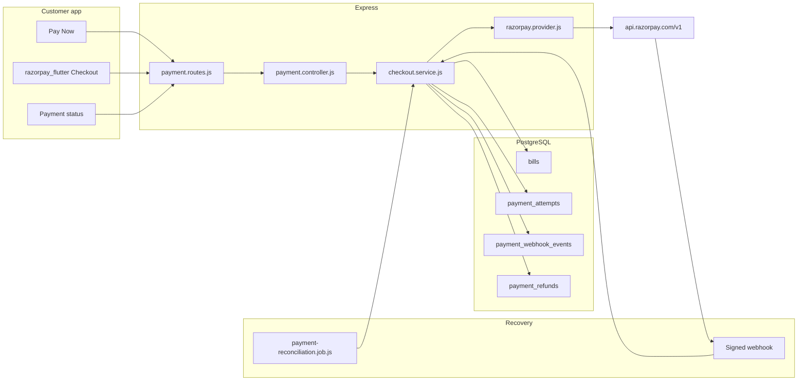
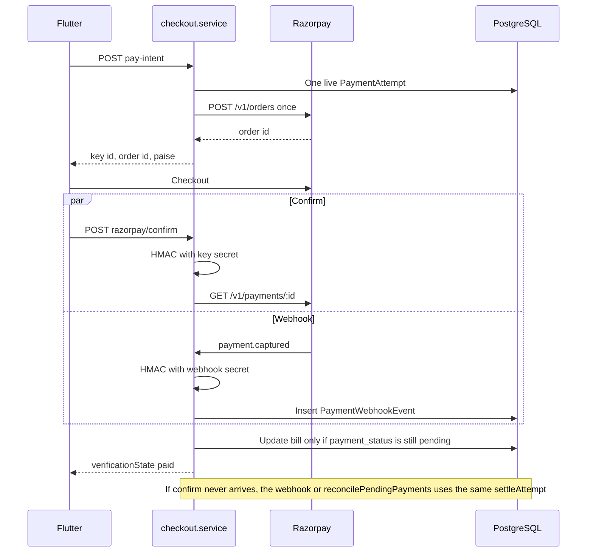
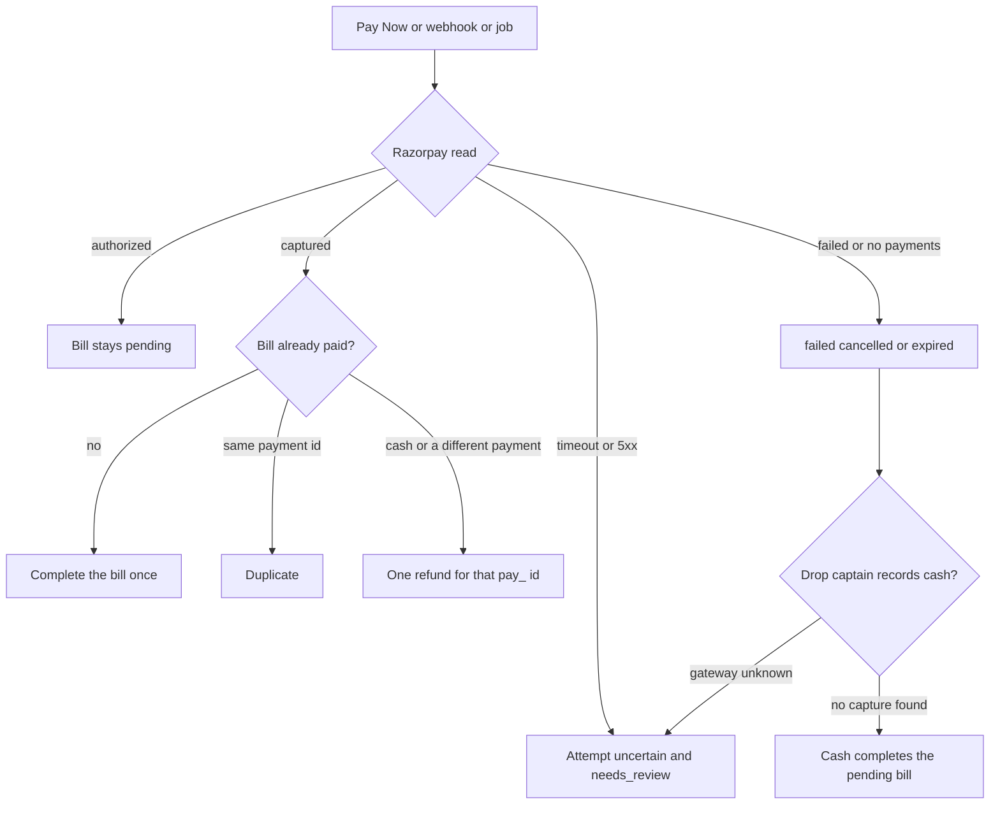

# Razorpay Payment Implementation Report

This report describes the payment code in the repository now. It was written from the source. It does not change application code. Secrets are not included. Real key values stay in `backend/.env`, which is gitignored.

The gateway is Razorpay. The backend does not use the Razorpay Node SDK. It calls `https://api.razorpay.com/v1` with `fetch` and HTTP Basic auth. The Flutter customer app opens Checkout with `razorpay_flutter`. The secret never goes to the app. Only the publishable key id is returned inside the pay-intent payload.

A laundry order has one `Bill`. Each try to pay that bill is a `PaymentAttempt`. Razorpay's order id is `PaymentAttempt.provider_ref`. After a captured online payment, Razorpay's payment id is `Bill.transaction_id` and also `PaymentAttempt.razorpay_payment_id`. Webhook deliveries are `PaymentWebhookEvent` rows. Refunds are `PaymentRefund` rows.

---

## 1. Executive summary

A customer cannot pay when they place the order. The bill is created later, when the pickup captain confirms the door count, in `confirmDoor` inside `backend/src/services/door.service.js`. The bill starts as `payment_status = pending`. Payment does not change the order status. `markDelivered` still requires a completed bill, the drop photo, and the assigned drop captain.

When the order is payable, the customer app calls `POST /api/v1/payments/orders/:orderId/pay-intent`. The server creates one live `PaymentAttempt` for `bill.final_amount` and asks Razorpay to create an order with `payment_capture: 1`. The amount is taken from the bill, in paise. Flutter's amount is ignored.

After Checkout, the app calls `POST /api/v1/payments/orders/:orderId/razorpay/confirm` with `razorpayOrderId`, `razorpayPaymentId`, and `razorpaySignature`. The server checks HMAC-SHA256 with `RAZORPAY_KEY_SECRET`, fetches the payment from Razorpay, and settles the bill only when that payment is `captured`, belongs to the same Razorpay order, and the paise match the attempt. `authorized` does not complete the bill.

Razorpay can also call `POST /api/v1/payments/webhook/razorpay`. The handler checks `x-razorpay-signature` over the raw body with `RAZORPAY_WEBHOOK_SECRET`, stores the event id, and runs the same settlement. A repeated processed event returns 200 and does not settle again. A handler error marks the event `failed` and returns 5xx so Razorpay retries.

If order creation times out, the attempt becomes `uncertain` and is not marked failed. A later Pay Now does not create a second Razorpay order. A background job reads pending, initiated, and uncertain attempts from Razorpay and settles captured ones. The job never calls `POST /orders`.

Cash is recorded by the assigned drop captain only while the order is `out_for_delivery`, and only after the latest attempt is `failed`, `cancelled`, or `expired`. If a Razorpay order exists, the server lists its payments first. A captured payment settles online instead of cash. If Razorpay cannot be reached, cash is blocked and the attempt is left for reconciliation.

If a captured payment arrives after the bill is already paid, the original bill stays. One refund row is created for that `pay_` id and Razorpay's refund API is called once. A second request returns the same row.

`POST /api/v1/payments/orders/:orderId/process` and `POST /api/v1/payments/process/:orderId` still return HTTP 410. The Flutter app no longer calls them. `processPayment` in the app throws locally and does not post a client-chosen status.

---

## 2. Technology stack

| Layer | What the code uses |
|---|---|
| Backend | Node.js, Express |
| Database | PostgreSQL through Prisma |
| Gateway | Razorpay Orders, Payments, and Refunds over `fetch` |
| Checkout | `razorpay_flutter` `^1.4.0` (resolved 1.4.7) |
| App HTTP | `dio`. Base URL already includes `/api/v1` |
| Auth | JWT. Customer routes use `authorize('customer')`. Manual refund uses `admin`, `owner`, or `super_admin` |
| Validation | Joi on confirm, refund reason, and the order id |
| Errors | `AppError` and subclasses, then `errorHandler` |
| Notifications | `emitOrderEvent` for `payment_received` and `payment_failed` |
| Recovery | BullMQ queue `payment-reconciliation` when Redis accepts the job within 3 seconds. Otherwise an in-process `setInterval` |

The `razorpay` npm package is not installed.

---

## 3. Architecture



Related files that are not the gateway itself:

| Path | Role |
|---|---|
| `backend/src/services/door.service.js` | `confirmDoor` creates the pending bill |
| `backend/src/services/payment.service.js` | `processPayment` always throws 410 |
| `backend/src/services/payments/provider.interface.js` | Comment-only contract. Exports `{}` |
| `backend/src/app.js` | Saves `req.rawBody` for webhook URLs |
| `backend/src/middleware/error.middleware.js` | JSON errors. Operational messages are kept |
| `backend/src/controllers/delivery-staff-app.controller.js` | Drop captain `recordCash` calls `checkout.recordCash` |
| `backend/src/server.js` | Starts and stops the reconciliation job |
| `backend/src/jobs/payment-reconciliation.job.js` | BullMQ or in-process scheduler |
| `customer-app/lib/services/payment_service.dart` | Pay intent, confirm, status, cancel |
| `customer-app/lib/screens/payment/payment_screen.dart` | Existing-bill Razorpay pay |
| `customer-app/lib/screens/orders/order_payment_screen.dart` | Order bill pay. COD does not fake success |

---

## 4. Payment sequence



Payable order statuses, from `PAYABLE` in `checkout.service.js`:

`picked_up`, `submitted_to_cm`, `received_by_collection`, `submitted_to_services`, `services_in_progress`, `services_completed`, `out_for_delivery`.

Step by step:

1. Pickup captain confirms the door count. The bill is inserted with `payment_status = pending` and `payment_method = null`.
2. Customer taps Pay Now.
3. `createPayIntent` rejects the call unless the order is payable and the bill is still pending.
4. If an attempt is `uncertain` and has no Razorpay order id, the server tries `GET /v1/orders?receipt=att_<attemptId>` and does not create another order.
5. If an attempt is pending and already has `provider_ref`, the server lists that order's payments. Captured payments settle. Authorized or unknown outcomes are returned as-is. A confirmed failure allows a new order.
6. Otherwise one attempt row is inserted. A partial unique index allows only one `initiated`, `pending`, or `uncertain` attempt per order. A unique conflict returns the existing row.
7. `createIntent` posts one Razorpay order. Receipt is `att_<attemptId>` trimmed to 40 characters. Notes contain `orderId` and `attemptId`. Amount is `Math.round(rupees * 100)`.
8. On timeout, HTTP 5xx, or network loss, the attempt becomes `uncertain`, `failure_reason = outcome_unknown`, `reconciliation_status = needs_review`. The API returns 503 with: `Your payment is being verified. Please don't pay again until we confirm its status.`
9. A definite Razorpay 4xx marks the attempt `failed` with `intent_failed`.
10. Flutter opens Checkout with `key`, `amount`, `currency`, and `order_id` from `attempt.intent`. It does not send its own amount.
11. On success, Flutter posts the three Razorpay fields to confirm.
12. Confirm verifies HMAC-SHA256 of `orderId|paymentId` using `RAZORPAY_KEY_SECRET` and `timingSafeEqual`.
13. Confirm `GET`s the payment. Reads retry. Writes do not.
14. Mismatched order id or amount is a validation error. The bill stays pending.
15. `authorized` sets `reconciliation_status = awaiting_capture` and returns 409 `PAYMENT_AWAITING_CAPTURE` with the verification sentence.
16. `failed` marks the attempt failed and returns 409 `PAYMENT_FAILED`.
17. Any other non-captured status returns 409 `PAYMENT_NOT_CAPTURED`.
18. `captured` calls `settleAttempt`. Inside a transaction, `bill.updateMany` matches `payment_status = pending`. Only one writer completes the bill. `payment_method` becomes the Razorpay method, default `upi`. `transaction_id` becomes the payment id. `payment_received` is emitted only when that update wins.
19. Flutter opens the success screen only when `verificationState` is an online paid state. A refund state shows a banner instead.

---

## 5. Failure and fallback flow



| Situation | Behavior |
|---|---|
| Payment captured, app never calls confirm | `payment.captured` or `order.paid` settles. The job also lists payments and settles. No second charge. |
| Customer closes Checkout | `POST /cancel-attempt` lists payments first. Empty list cancels the attempt. Captured settles. Authorized or unreachable leaves the attempt open. |
| Order create times out | Attempt stays `uncertain`. Next Pay Now does not call `POST /orders` again. |
| Read timeout | Up to `PAYMENT_MAX_RETRIES` attempts, backoff 200ms, 400ms, 800ms. Capped at 5. `POST /orders` and `POST /refund` are not retried. |
| Duplicate confirm or webhook | Event id is unique. Bill update matches pending. Second writer returns `duplicate` and does not emit `payment_received` again. |
| Confirm and webhook together | The transaction serializes the two settlements. One completion, one notification. |
| Cash | Drop captain, `out_for_delivery`, bill pending, latest attempt `failed`, `cancelled`, or `expired`, and a gateway read that is not captured, authorized, or unknown. |
| Late capture after cash | Bill stays cash. `failure_reason = refund_required`. One `PaymentRefund` and one Razorpay refund for that payment id. |
| Authorized only | Bill stays pending. Reconciliation keeps reading until capture, failure, or review. |
| App resumes | `GET /payment-status`. Screens refresh on resume. |

`verificationState` values: `unpaid`, `pending`, `verifying`, `paid`, `paid_cash`, `failed`, `cancelled`, `expired`, `unknown`, `refund_pending`, `refund_completed`.

A processed refund forces `refund_completed`. A pending or failed refund forces `refund_pending`, even if the bill is completed, so the app does not show a fresh success screen for that case.

---

## 6. APIs

Mounted at `/api/v1/payments`.

| Method and path | Auth | What it does |
|---|---|---|
| `POST /orders/:orderId/pay-intent` | Customer JWT | Create or reuse the open Razorpay order |
| `POST /orders/:orderId/razorpay/confirm` | Customer JWT | Verify signature and settle only if captured |
| `POST /orders/:orderId/cancel-attempt` | Customer JWT | Cancel only after Razorpay shows nothing captured |
| `GET /orders/:orderId/payment-status` | Customer JWT | Bill, attempt, refund, `verificationState` |
| `POST /webhook/:provider` | None. HMAC on raw body | Razorpay events. Provider must be `razorpay` |
| `POST /orders/:orderId/refund` | `admin`, `owner`, `super_admin` | Manual refund of a captured online payment. Body `{ "reason": "..." }` at least 3 characters |
| `POST /orders/:orderId/process` and `POST /process/:orderId` | Customer JWT | HTTP 410 |
| `GET /orders/:orderId/bill` and invoice aliases | Customer JWT | Bill from `door.service` |
| `POST /orders/:orderId/coupon` and `DELETE` | Customer JWT | Coupon only while the bill is unpaid and no live attempt exists |
| `POST /api/v1/delivery-staff-app/orders/:orderId/record-cash` | Drop captain JWT | Cash after the gateway check |

Confirm body:

```json
{
  "razorpayOrderId": "order_xxx",
  "razorpayPaymentId": "pay_xxx",
  "razorpaySignature": "hex hmac"
}
```

Pay-intent success `data` is `presentPayment`: order id, bill amounts as strings, `paymentStatus`, `paymentMethod`, `transactionId`, `verificationState`, `refund`, and `attempt`. `attempt.intent` holds `keyId`, `razorpayOrderId`, `amount` in paise, and `currency`.

Error JSON from `error.middleware.js`:

```json
{
  "success": false,
  "message": "human readable message",
  "errorCode": "PAYMENT_OUTCOME_UNKNOWN",
  "timestamp": "...",
  "path": "/api/v1/payments/..."
}
```

Important error codes: `PAYMENTS_NOT_CONFIGURED` 503, `PAYMENT_OUTCOME_UNKNOWN` 503, `RAZORPAY_RATE_LIMIT` 503, `RAZORPAY_ERROR` 502, `PAYMENT_AWAITING_CAPTURE` 409, `PAYMENT_NOT_CAPTURED` 409, `PAYMENT_FAILED` 409, `BILL_ALREADY_PAID` 409, `CASH_NOT_ALLOWED` 409, `REFUND_NOT_ALLOWED` 409, `REFUND_ALREADY_ISSUED` 409, `UNAUTHORIZED` 401 for a bad signature.

Webhook events that are handled:

| Razorpay event | Result |
|---|---|
| `payment.captured` | Settle as succeeded if the amount matches |
| `order.paid` | Same. If the payload has no payment id, the server lists the order's payments |
| `payment.failed` | Mark the attempt failed unless the bill is already completed |
| `payment.authorized` | Do not settle. Set `awaiting_capture` |
| `refund.processed` | Update the refund row to `processed` |
| `refund.failed` | Update the refund row to `failed` |
| Anything else signed | Store the event and ignore it |

The event id is header `x-razorpay-event-id`. If that header is missing, the id is SHA-256 of the raw body. HTTP 200 is sent only after the row is saved and the handler finishes. Events are not assumed to arrive in order. The raw body is not stored, so a failed event is not replayed from the database. Razorpay's own retry, and the reconciliation poll, are the recovery paths. Failed events are logged for review.

---

## 7. Settlement and refunds

`settleAttempt` is the only online completion path.

- Same successful online payment again: `{ duplicate: true }`. No second notification.
- Failed payment after the bill is already completed, or after the attempt already succeeded or failed: duplicate. A late failure does not unpay the bill.
- Bill already cash, or already paid online with a different transaction id: attempt `succeeded`, `failure_reason = refund_required`. Then `issueRefund`.
- Otherwise `updateMany` where `payment_status = pending`. If that updates zero rows, the payment is treated as a refund case.

`issueRefund` uses idempotency key `refund:<payment id>`.

- Only ids that start with `pay_` are sent to Razorpay. An order id is not refunded automatically.
- One row per payment id. A unique conflict reads the existing row.
- If a refund id is already stored, the server `GET`s `/refunds/:id` before creating another.
- `POST /payments/:id/refund` is not retried. Timeout leaves the row `pending` for the job.
- A Razorpay "already refunded" error marks the row `processed`.
- The job retries `pending` refunds. It does not loop on `failed` refunds.
- An uncertain payment is not refunded.

A manual refund requires the bill to be completed, the method not cash, and a stored transaction id. The server fetches the payment and requires status `captured` or `refunded`. It writes an audit log with the actor id, order id, and refund status. It does not log the signature or the secret.

Decision that was not guessed: a refund does not set `Bill.payment_status` to `refunded` and does not change the order. The cash or original online payment record stays, so delivery rules stay the same. Say if a processed refund should instead mark the bill refunded or cancel the order.

---

## 8. Reconciliation

`backend/src/jobs/payment-reconciliation.job.js` starts from `server.js` and stops on shutdown.

- `NODE_ENV=test` does not start it. Production must not use `NODE_ENV=test`.
- `PAYMENT_RECONCILIATION_ENABLED=false` turns it off and logs that.
- Otherwise it tries a BullMQ repeatable job named `payment-reconciliation`.
- If Redis does not accept the job within 3 seconds, it logs `Payment reconciliation is using the in-process scheduler` and uses `setInterval`. That is the fallback, not a silent disable.
- Each run calls `checkout.reconcilePendingPayments`. A run already in progress is skipped.
- Interval is `PAYMENT_RECONCILIATION_INTERVAL_MINUTES`, default 5.
- It selects up to 50 attempts in `initiated`, `pending`, or `uncertain`, with `check_count` under 20, whose `last_checked_at` is null or older than the interval.
- With a Razorpay order id, it lists payments and uses `settleAttempt` for a capture.
- With no order id, it tries the receipt lookup. If that fails, it increments `check_count`, sets `uncertain` and `needs_review`, and does not mark the attempt failed. At 20 checks it logs that the attempt needs a person.
- If a successful read shows no payments, the bill is still pending, and the attempt is older than `PAYMENT_ATTEMPT_STALE_MINUTES` (default 30), the attempt becomes `expired`. That is the only automatic expiry, and it happens only after Razorpay showed no payments.
- Pending refunds are checked or submitted again. Failed webhook rows are counted and logged. They are not replayed, because the body was not stored.

`findOrderByReceipt` calls `GET /v1/orders?receipt=...` and keeps an item only when `receipt` matches. Razorpay's order list does not officially filter by receipt. A 4xx returns null. The attempt then stays `needs_review` and is not charged again.

---

## 9. Database

`Bill` is unchanged in its payment columns. It now has `payment_refunds`. `payment_status` is still `pending`, `completed`, `failed`, or `refunded`. Settlement writes `pending` or `completed`. It does not write `failed` or `refunded` on the bill. `payment_method` is null until paid, then the Razorpay method or `cash`. `cash_recorded_by` is the drop captain id for cash. `transaction_id` is the Razorpay payment id after an online capture.

`PaymentAttemptStatus`: `initiated`, `pending`, `succeeded`, `failed`, `cancelled`, `expired`, `uncertain`.

`PaymentAttempt` columns that matter:

| Column | Meaning |
|---|---|
| `provider` | `razorpay` |
| `provider_ref` | Razorpay order id `order_...` |
| `razorpay_payment_id` | Unique nullable payment id `pay_...` |
| `idempotency_key` | Unique. Default `pay:<orderId>:<billId>:<n>` |
| `amount` | Bill final amount at the time of the attempt |
| `intent_payload` | `{ provider, keyId, razorpayOrderId, amount, currency }` |
| `failure_reason` | `intent_failed`, `outcome_unknown`, `gateway_unreachable`, `refund_required`, `stale`, `customer_cancelled`, or the gateway error |
| `last_checked_at` | Last reconciliation or gateway read |
| `check_count` | How many times reconciliation has looked |
| `reconciliation_status` | `needs_review`, `awaiting_capture`, or null |

Indexes: `(order_id, status)`, `provider_ref`, `(status, last_checked_at)`, unique `razorpay_payment_id`, unique `idempotency_key`.

SQL-only partial unique index, which Prisma cannot model:

```sql
CREATE UNIQUE INDEX "payment_attempts_one_live_per_order"
ON "payment_attempts" ("order_id")
WHERE "status" IN ('initiated', 'pending', 'uncertain');
```

`PaymentWebhookEvent`: unique `event_id`, `event_name`, `status` (`received`, `processed`, `failed`), optional `attempt_id`, short `error`, `created_at`, `processed_at`.

`PaymentRefund`: `attempt_id`, `bill_id`, `razorpay_payment_id`, unique `razorpay_refund_id`, `amount`, `status` (`pending`, `processed`, `failed`), `reason`, unique `idempotency_key`, `created_by` (`system`, `webhook`, or the staff id).

Migrations, which only add an enum value, columns, tables, and indexes:

- `backend/prisma/migrations/20261119120000_payment_attempt_uncertain/migration.sql`
- `backend/prisma/migrations/20261119120100_payment_reconciliation_refunds/migration.sql`

The enum value is its own migration because PostgreSQL cannot use a new enum value in the same transaction as the partial index. These were applied to the local `laundry_test` database. They were not applied to production. That same test deploy also applied an older pending test migration, `20261022120000_customer_notifications`.

---

## 10. Provider

`backend/src/services/payments/razorpay.provider.js`.

- Base URL `https://api.razorpay.com/v1`.
- Basic auth is `RAZORPAY_KEY_ID:RAZORPAY_KEY_SECRET`. Missing keys throw 503 `PAYMENTS_NOT_CONFIGURED`.
- Each request uses `AbortController` and `PAYMENT_API_TIMEOUT_MS`, default 10000.
- Timeout, network failure, HTTP 429, and HTTP 5xx become `PAYMENT_OUTCOME_UNKNOWN` or `RAZORPAY_RATE_LIMIT`. Those are uncertain.
- HTTP 4xx becomes `RAZORPAY_ERROR` and is definite, except the refund "already refunded" case, which is `REFUND_ALREADY_ISSUED`.
- `createIntent` is one POST. It is not retried.
- `fetchPayment`, `fetchOrder`, `listOrderPayments`, `findOrderByReceipt`, and `fetchRefund` are reads and are retried.
- `createRefund` is one POST to `/payments/:id/refund` with the amount in paise and a note. It is not retried.
- `summarizePayments` prefers `captured`, then `authorized`, then all-failed, otherwise `none`.
- Checkout HMAC: `HMAC-SHA256(key secret, orderId + "|" + paymentId)`.
- Webhook HMAC: `HMAC-SHA256(webhook secret, raw body)`.
- Comparison uses `crypto.timingSafeEqual` after a length check, so a length mismatch does not throw.

---

## 11. Flutter

`customer-app/lib/services/payment_service.dart`

- `createPayIntent` posts `/payments/orders/:orderId/pay-intent`.
- `confirmRazorpay` posts the three Razorpay fields.
- `paymentStatus` gets `/payments/orders/:orderId/payment-status`.
- `cancelAttempt` posts `/payments/orders/:orderId/cancel-attempt`.
- `processPayment` does not call the network. It throws and tells the caller the app cannot mark a method as paid.
- `paymentVerificationMessage` is exactly: `Your payment is being verified. Please don't pay again until we confirm its status.`
- `describePaymentError` uses that sentence for timeouts, network failures, and the server verification message.
- `PayIntentResult.isPaidOnline` is true only when `paymentStatus` is `completed`, the method is not cash, and the state is not a refund state.

`payment_screen.dart` is the existing-bill pay screen. It loads status when opened, refreshes when the app resumes, opens Checkout from the intent, confirms on success, and calls cancel when Razorpay reports `PAYMENT_CANCELLED` (code 2). A new order from the cart no longer calls `processPayment` and no longer opens the payment-success screen. The bill does not exist yet. The screen goes to the order-success route.

`order_payment_screen.dart` uses the same Razorpay path for card methods. COD does not navigate to success. It shows: `Cash is collected by the captain after an online payment fails. It is not marked paid here.`

The success screen is shown only after the backend says the online payment completed.

---

## 12. Security

| Control | Where |
|---|---|
| Key secret only on the server | `razorpay.provider.js`. Flutter receives `keyId` only |
| Webhook secret only on the server | `verifyWebhook`. Missing secret is 503, not a skipped check |
| Checkout signature | HMAC-SHA256 and `timingSafeEqual` |
| Webhook signature | HMAC-SHA256 over the raw body, header `x-razorpay-signature` |
| Amount | `bill.final_amount` and Razorpay's payment amount. Flutter's amount is not stored |
| Status | Razorpay `captured` or a signed webhook. Flutter cannot post `payment_status` |
| One completion | `updateMany` where `payment_status = pending` |
| One open attempt | Partial unique index |
| One refund per payment | Unique `idempotency_key` `refund:<pay_ id>` |
| Webhook replay | Unique `event_id`. Processed events return duplicate |
| Cash authority | Assigned drop captain, `out_for_delivery`, gateway check |
| Manual refund authority | JWT role `admin`, `owner`, or `super_admin`, plus a reason |
| Logs | Order id, attempt id, refund id, status. Not the secret, signature, or card data |
| Deprecated pay endpoint | HTTP 410 |

`backend/.env` and `backend/.env.test` are listed in `backend/.gitignore`. The repo `.gitignore` also ignores `.env`.

---

## 13. Environment

Names only. Put real values in `backend/.env`. Do not commit them. `backend/env.template` has the same names with empty secrets.

```env
RAZORPAY_KEY_ID=rzp_test_xxxxx
RAZORPAY_KEY_SECRET=your_secret
RAZORPAY_WEBHOOK_SECRET=your_webhook_secret

PAYMENT_RECONCILIATION_ENABLED=true
PAYMENT_RECONCILIATION_INTERVAL_MINUTES=5
PAYMENT_API_TIMEOUT_MS=10000
PAYMENT_MAX_RETRIES=3
PAYMENT_ATTEMPT_STALE_MINUTES=30
```

The test key id and test key secret are set in `backend/.env`. `RAZORPAY_WEBHOOK_SECRET` is still a placeholder. A webhook posted by Razorpay will return 503 until that dashboard secret is saved and the API is restarted.

There is no `NEXT_PUBLIC_`, `VITE_`, or `REACT_APP_` Razorpay variable. This frontend is Flutter. The key id is delivered by pay-intent, not compiled into the app.

Jest `backend/tests/setup-env.js` forces test values `rzp_test_laundry`, `test_secret`, and `whsec_test` so the placeholder or the real test key in `.env` does not leak into unit tests.

---

## 14. How to test

Restart the API after changing `.env`, from `backend`:

```text
npm run dev
```

Then, in the customer app, open an order whose bill exists and tap Pay. Razorpay test card: `4111 1111 1111 1111`, any future expiry, any CVV, OTP `1234`. The app must call confirm. The bill becomes paid only after Razorpay reports `captured`.

Direct test-mode API checks already run, with no capture and no refund:

| Check | Result |
|---|---|
| `POST /v1/orders` with 50 paise | HTTP 400 |
| `POST /v1/orders` with 100 paise | `order_U1xpz368bxQkiO`, status `created`, currency INR |
| Read that order back | HTTP 200, same id and amount |
| App `createIntent` for ₹1.00 | `order_U1xqTDwCh0DMHK`, 100 paise |
| HMAC of `orderId\|paymentId` with the key secret | Accepted by `verifyCheckoutSignature` |
| Different signature | Rejected |

Those two orders are unpaid test orders. They are not attached to a laundry bill.

Automated tests, Razorpay HTTP mocked except the two orders above:

| Suite | Result |
|---|---|
| `backend/tests/unit/payment-lifecycle.test.js` | 18 passed |
| `backend/tests/unit/razorpay.provider.test.js` | 8 passed |
| `business-rules`, `order-flow`, `schedule-rules` | 13 passed |
| `backend/tests/e2e/order-lifecycle.test.js` on `laundry_test` | 11 passed, including pay, duplicate webhook, cash after a failed attempt, and a late capture that keeps the bill as cash and returns `refundRequired` |
| `npx prisma validate` and `prisma generate` | Schema valid, client 6.19.2 |
| `dart analyze` on the payment service, repository, and both payment screens | No errors. Existing infos only |

The 18 lifecycle cases cover success, bad signature, wrong amount, failed payment, checkout cancel, webhook without confirm, duplicate confirm, duplicate webhook, confirm/webhook race, order-create timeout, cash after a confirmed failure, cash blocked when Razorpay cannot be reached, late capture after cash, one refund per payment, refund webhook update, authorized confirm, authorized webhook, and reconciliation of a pending attempt.

---

## 15. What is not verified

- No card was entered in Checkout. No payment was captured. No refund was sent to Razorpay.
- Razorpay's servers have not delivered a webhook. Signature tests used locally signed bodies. The webhook secret in `.env` is still a placeholder.
- The BullMQ worker was not started against Redis in a test. `reconcilePendingPayments` was tested. The 3-second Redis fallback was not exercised against a stopped Redis.
- Stale expiry after `PAYMENT_ATTEMPT_STALE_MINUTES` is implemented and does not have its own test.
- The admin refund route was not called over HTTP. Refund creation, the unique key, and the refund webhook were tested through the service with Razorpay mocked.
- Flutter was not run on a device for this pass. Analyzer does not show the button, the resume refresh, or the banner.
- Production was not migrated and production payment settings were not changed.

---

## 16. Deployment

1. Set the variables in section 13. Use `rzp_live_...` only when you intend live charges.
2. Set `RAZORPAY_WEBHOOK_SECRET` to the secret shown in the Razorpay dashboard.
3. Run `npx prisma migrate deploy` on the target database. Do not point that command at a database you have not chosen. The local test database is already migrated.
4. Expose `POST /api/v1/payments/webhook/razorpay` on public HTTPS. Subscribe to `payment.captured`, `payment.failed`, `payment.authorized`, `order.paid`, `refund.processed`, and `refund.failed`.
5. Keep Redis available. If it is down at startup, the in-process scheduler still runs and logs that fact.
6. Restart the API.

---

## 17. Files

Created for this payment work:

- `backend/prisma/migrations/20261119120000_payment_attempt_uncertain/migration.sql`
- `backend/prisma/migrations/20261119120100_payment_reconciliation_refunds/migration.sql`
- `backend/src/jobs/payment-reconciliation.job.js`
- `backend/tests/helpers/payment-memory.js`
- `backend/tests/unit/payment-lifecycle.test.js`
- `PAYMENT_IMPLEMENTATION_SUMMARY.md`
- `.tmp/razorpay-live-check.js` (local test script, not part of the app)

Modified:

- `backend/prisma/schema.prisma`
- `backend/src/services/payments/razorpay.provider.js`
- `backend/src/services/payments/checkout.service.js`
- `backend/src/controllers/payment.controller.js`
- `backend/src/routes/payment.routes.js`
- `backend/src/server.js`
- `backend/env.template`
- `backend/.env` (names and values on disk only; not committed)
- `backend/tests/helpers/flow.js`
- `backend/tests/unit/razorpay.provider.test.js`
- `customer-app/lib/services/payment_service.dart`
- `customer-app/lib/repositories/payment_repository.dart`
- `customer-app/lib/screens/payment/payment_screen.dart`
- `customer-app/lib/screens/orders/order_payment_screen.dart`

`PAYMENT_IMPLEMENTATION_SUMMARY.md` is the short version of this report. This file is the detailed one.
