# WashBee locked order flow — verification diagrams

**Source of truth:** [order-flow-spec.md](../order-flow-spec.md)  
**Purpose:** visual check before development. If a box disagrees with the spec, the spec wins until you correct it here.  
**How to view:** open this file in Cursor preview (Mermaid), or open [viewer.html](viewer.html) for the full set.

Shapes: stadium = start/end · rectangle = step · diamond = decision · cylinder = DB write · parallelogram = actor sees / UI.

---

## 0. Who does what (map)

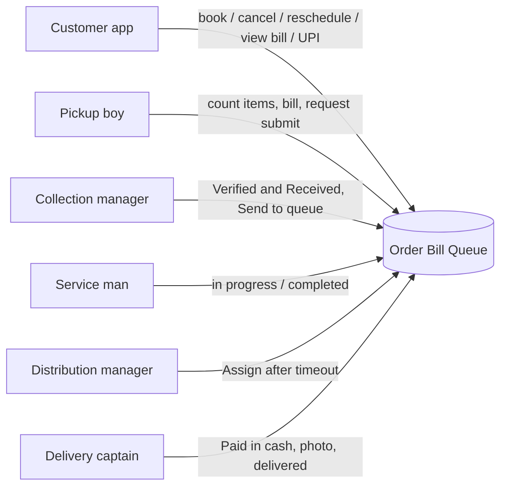

---

## 1. Master spine (happy path)

Ordinary order. Express skips schedule and jumps the service-queue band (diagram 9).

```mermaid
flowchart TB
  book([Customer books services]) --> confirm[Confirm: no item bill]
  confirm --> placed[Status: placed]
  placed --> pSearch{Pickup instant?}
  pSearch -->|yes| pNow[Pickup search starts now]
  pSearch -->|no| pWait[Wait until pickup_time_from]
  pWait --> pNow
  pNow --> pWin{Partner accepts or timeout?}
  pWin -->|accept first write wins| pAsg[pickup_assigned]
  pWin -->|timeout| cmForce[CM force-assign: cannot reject]
  cmForce --> pAsg
  pAsg --> track1[Customer tracking ON: Out for pickup]
  track1 --> door[Boy: count / weigh / photo per service]
  door --> draft[Server draft until Mark as picked up]
  draft --> markPU[Mark as picked up]
  markPU --> bill[(Bill written: services + DELIVERY_FEE + EXPRESS_FEE if any)]
  bill --> picked[Status: picked_up]
  picked --> viewBill[Customer: View bill only. Tracker: Pickup done]
  viewBill --> req[Button: Submit request to CM]
  req --> subCm[Status: submitted_to_cm]
  subCm --> waitBtn[Button inactive: Waiting for CM verification]
  waitBtn --> cmRecv[CM: Verified and Received]
  cmRecv --> recv[Status: received_by_collection]
  recv --> sendQ[CM: Send to service queue]
  sendQ --> subSvc[Status: submitted_to_services]
  subSvc --> qRows[Queue rows: one per service item]
  qRows --> smWork[SM: In progress / Completed. Poll 2 min]
  smWork --> anyDone{Any item completed?}
  anyDone -->|yes| dmPlant[DM in-plant list: expand all items]
  smWork --> allDone{All items completed?}
  allDone -->|yes| ready[Status: services_completed. Tracker: Ready]
  ready --> dropStart{Delivery instant OR time reached?}
  dropStart -->|future scheduled| dmHold[Ready-to-dispatch: Assign disabled Available from time]
  dropStart -->|yes| dSearch[Drop search same engine as pickup]
  dSearch --> dWin{Accept or timeout?}
  dWin -->|accept| ofd[Status: out_for_delivery]
  dWin -->|timeout| dmAsg[DM Assign enabled: cannot reject]
  dmAsg --> ofd
  ofd --> pay[Customer UPI. Fail: boy Paid in cash]
  pay --> paid[(bill.payment_status completed)]
  paid --> photo[Boy: one drop photo]
  photo --> deliv([Status: delivered])
```

---

## 2. Customer booking

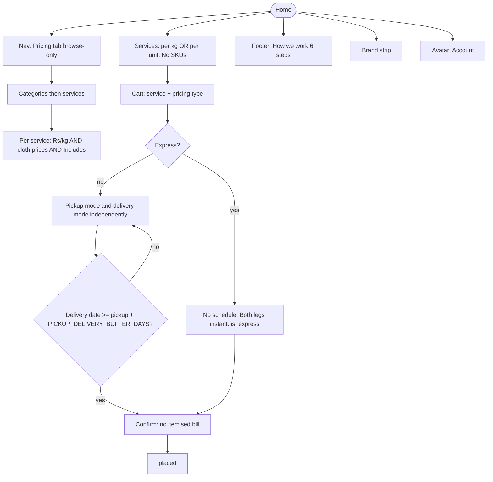

---

## 3. Cancel and reschedule (only while placed)

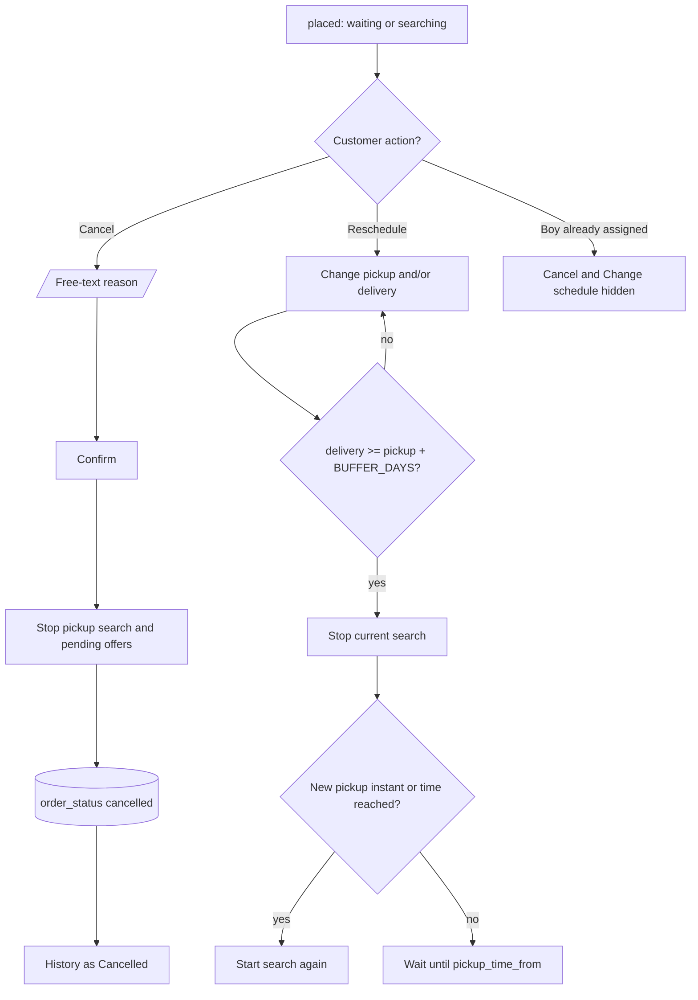

After `pickup_assigned`: **no** cancel, **no** reschedule. Express: **no** Change schedule (nothing to schedule). Express cannot convert to ordinary. Cancel still allowed only before pickup assigned.

---

## 4. Pickup assignment engine (also drop)

Config: `ASSIGNMENT_TIMEOUT_MINUTES` 5/10/20 · `ASSIGNMENT_RANGE_SLICES` 5 · `ASSIGNMENT_MAX_RANGE_KM` · on-shift only · Google Maps road distance.

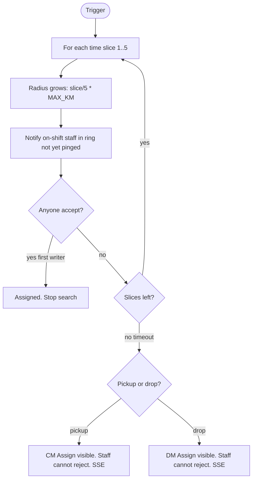

| Job | Starts when |
|---|---|
| Pickup instant | Place order |
| Pickup scheduled | `pickup_time_from` |
| Drop instant (incl. Express) | All service items completed |
| Drop scheduled | All completed **and** `now >= delivery_time_from` |
| Drop scheduled, still in the future | No search. DM Assign disabled: Available from {time} |

During search: manager Assign is **visible but disabled**. After timeout: **enabled**. Late plant (completed after slot): drop search **immediately**.

---

## 5. Door count, bill, CM handshake

Pickup-boy **one button**, three labels.

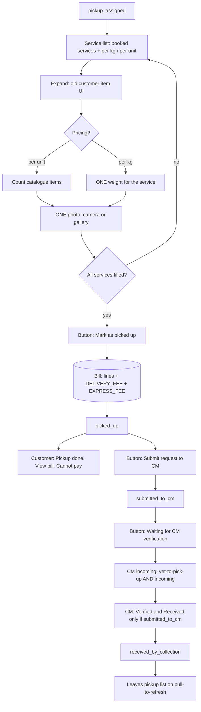

Draft: PATCH items with `items_confirmed=false` on each service expander. App kill: GET DB + `assigned_at`. No Mark for later. No edit after Mark as picked up. No boy cancel of request.

---

## 6. Plant: CM send → service man → DM

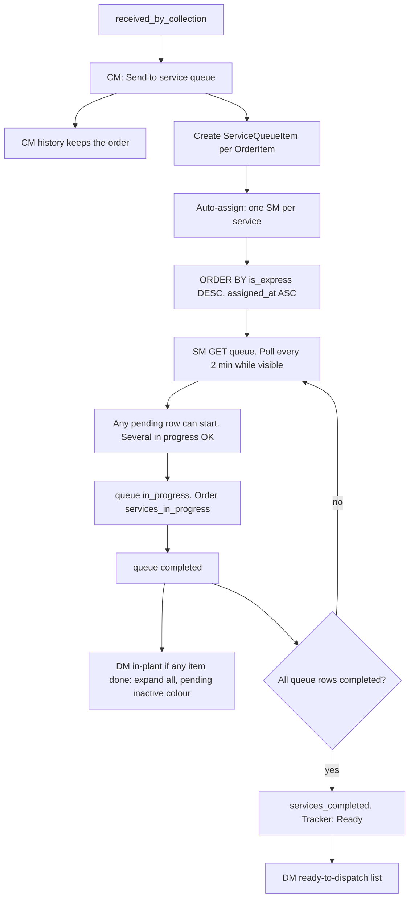

New ordinary rows: bottom of ordinary band. New Express: after older Express, before ordinary. No SSE. No two queues.

---

## 7. Drop assignment, map, pay, delivered

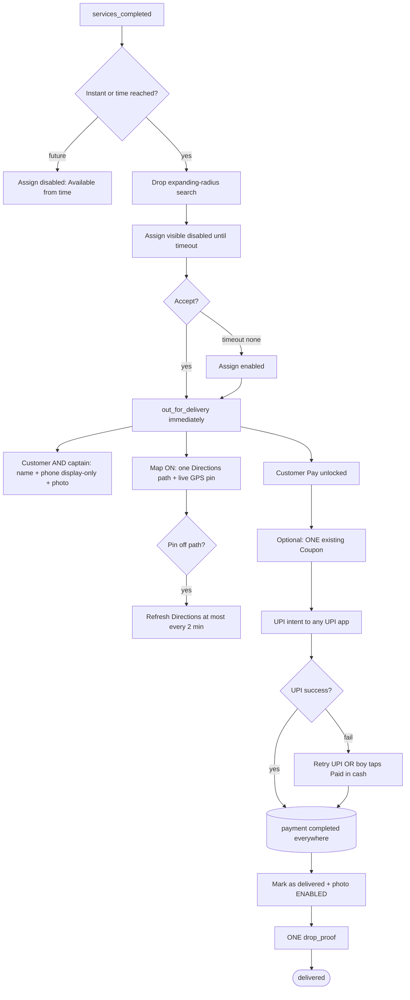

Order leaves DM ready-to-dispatch at assignment; **history** shows delivered or not. No Start-delivery status gate. No cash as first option. Delivered blocked until payment completed. Do not set `payment_pending` on the order after UPI.

---

## 8. Order status machine

Customer tracker vs DB. Tracking screen **hidden until pickup_assigned**.

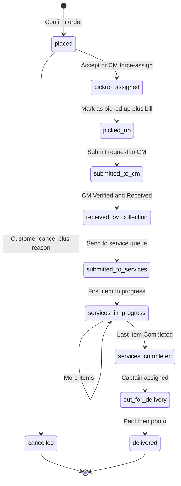

| DB status | Customer tracker |
|---|---|
| placed | No tracking |
| pickup_assigned | Out for pickup |
| picked_up | Pickup done |
| submitted_to_cm / received_by_collection / submitted_to_services / services_in_progress | In Process |
| services_completed (searching or waiting slot) | Ready |
| out_for_delivery | Out for delivery |
| delivered | Delivered |
| cancelled | History: Cancelled |

---

## 9. Express (overlay on the same spine)

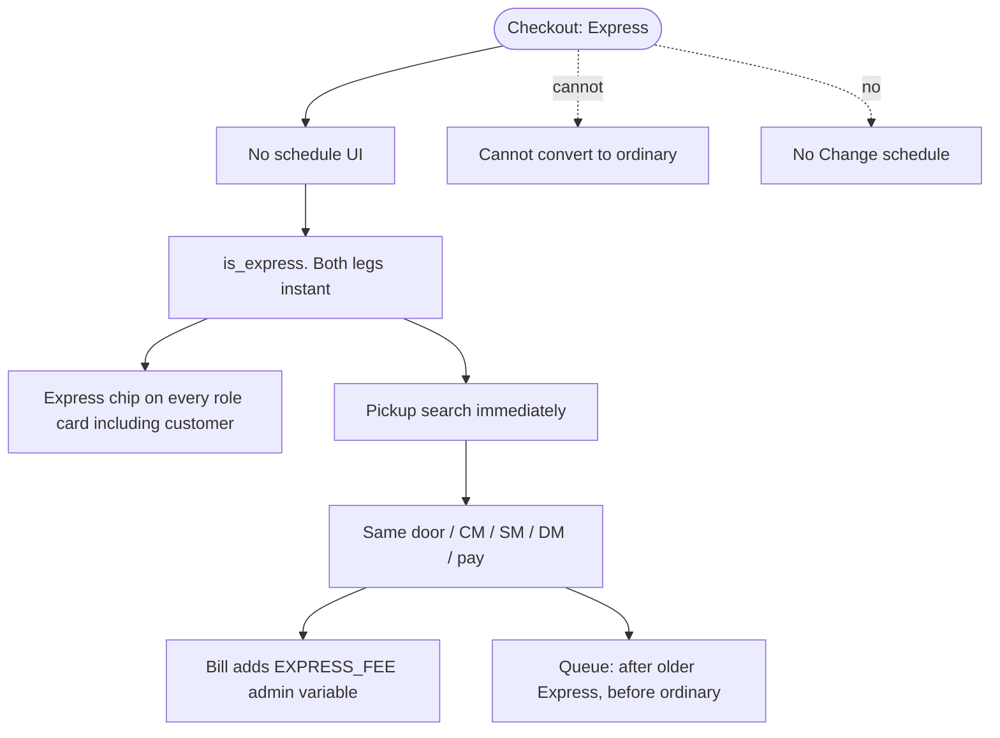

---

## 10. Actor lists (where the order sits)

```mermaid
flowchart TB
  subgraph pickupBoy [Pickup boy]
    pb1[Assigned active] --> pb2[After CM receive: gone on pull-to-refresh]
  end
  subgraph cm [Collection manager]
    cm1[Incoming: yet to pick up + incoming] --> cm2[Received list]
    cm2 --> cm3[After send-to-queue: history]
  end
  subgraph sm [Service man]
    sm1[His service queue] --> sm2[Completed tab]
  end
  subgraph dm [Distribution manager]
    dm1[In-plant: some items done] --> dm2[Ready to dispatch: all done, no captain]
    dm2 --> dm3[History: assigned onward, delivered or not]
  end
  subgraph cust [Customer]
    c1[Active / Orders] --> c2[History includes Cancelled]
  end
```

---

## 11. Button / event cheat sheet

| When | Who | Event | Status / data |
|---|---|---|---|
| Confirm checkout | Customer | Place | `placed` |
| Cancel | Customer | Reason + confirm | `cancelled` |
| Reschedule | Customer | New pickup and/or delivery | Stop search; restart or wait |
| Accept offer | Pickup boy | First write | `pickup_assigned` |
| Timeout | CM | Force-assign | `pickup_assigned` |
| Each service expander | Pickup boy | Draft PATCH | items not confirmed |
| Mark as picked up | Pickup boy | Bill | `picked_up` |
| Submit request to CM | Pickup boy | | `submitted_to_cm` |
| Verified and Received | CM | | `received_by_collection` |
| Send to service queue | CM | Queue rows | `submitted_to_services` |
| In progress | SM | | `services_in_progress` |
| Completed last item | SM | | `services_completed` |
| Accept drop / DM assign | Captain / DM | Map on | `out_for_delivery` |
| UPI success | Customer | | `bill.payment_status=completed` |
| Paid in cash | Delivery boy | After UPI fail | same |
| Mark delivered + photo | Delivery boy | Only if paid | `delivered` |

---

## 12. What this pack deliberately omits

- Admin laundry-admin screens except config variables already named.
- Call/message: **display placeholders** (phone number shown, not `tel:`).
- CM refuse / recount (later).
- Booking fee (will not be added).
- Two service queues, Redis for SM, SSE for SM queue.

Mark the box that is wrong and we correct the spec before coding.
