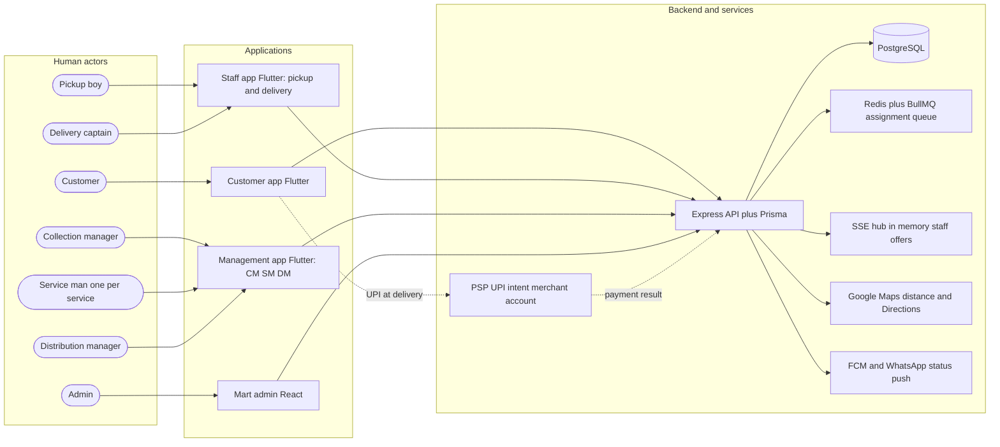
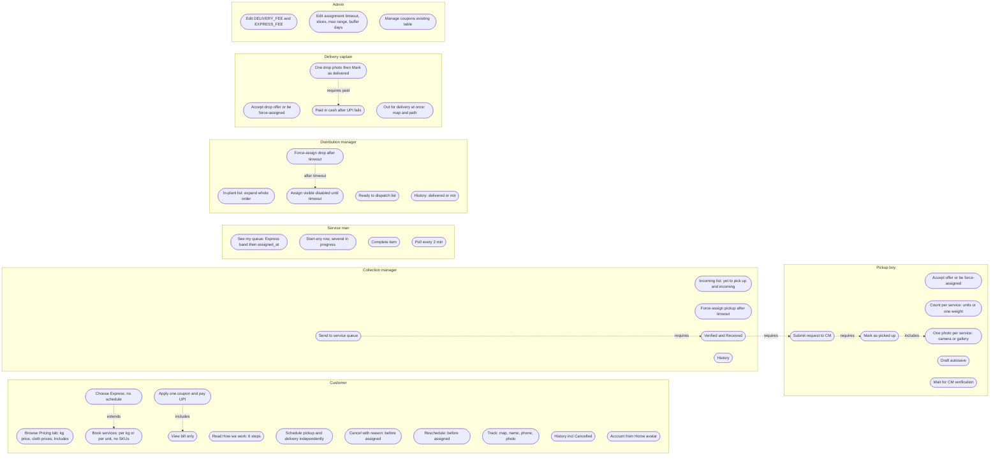

# Actors, apps and use cases

> Part of the order-flow v2 pack. Source of truth: [`../order-flow-spec.md`](../order-flow-spec.md). Mermaid renders in GitHub / Cursor preview.

## 1. Actors and apps

Same Staff app / management app shell hosts several roles in this codebase; role is decided at login. Pickup boy and captain are the same `DeliveryStaff` account type (pickup leg vs drop leg).

## 2. Use-case diagram (every actor, every capability)

