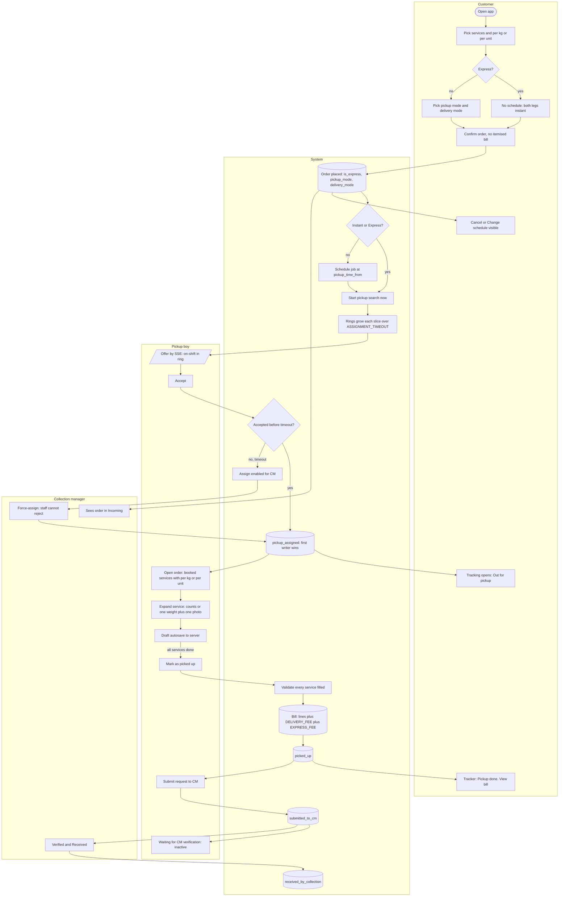
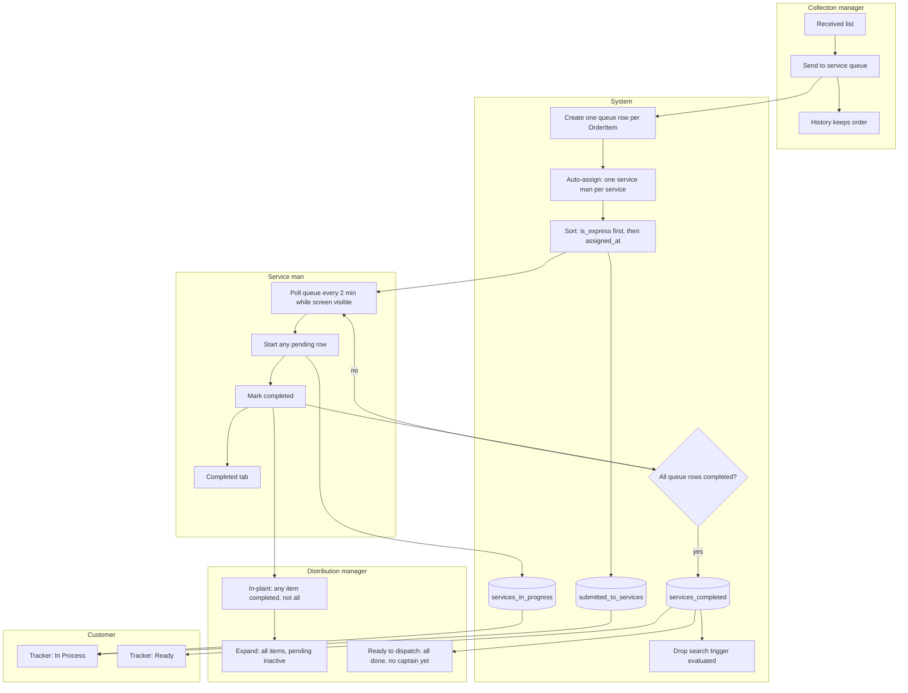
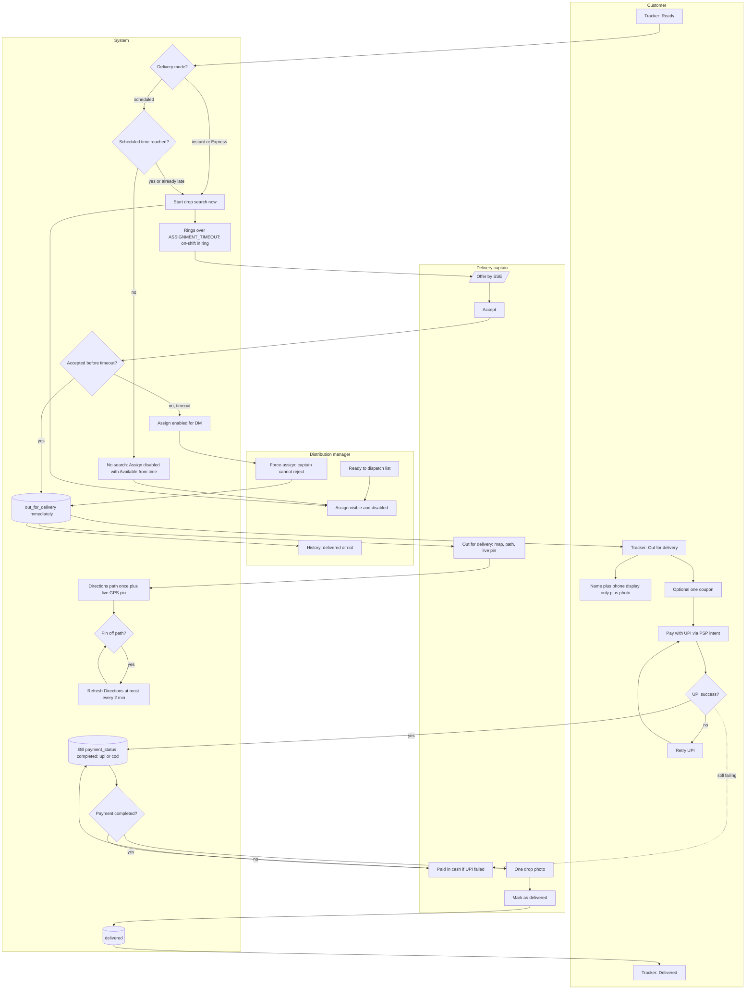
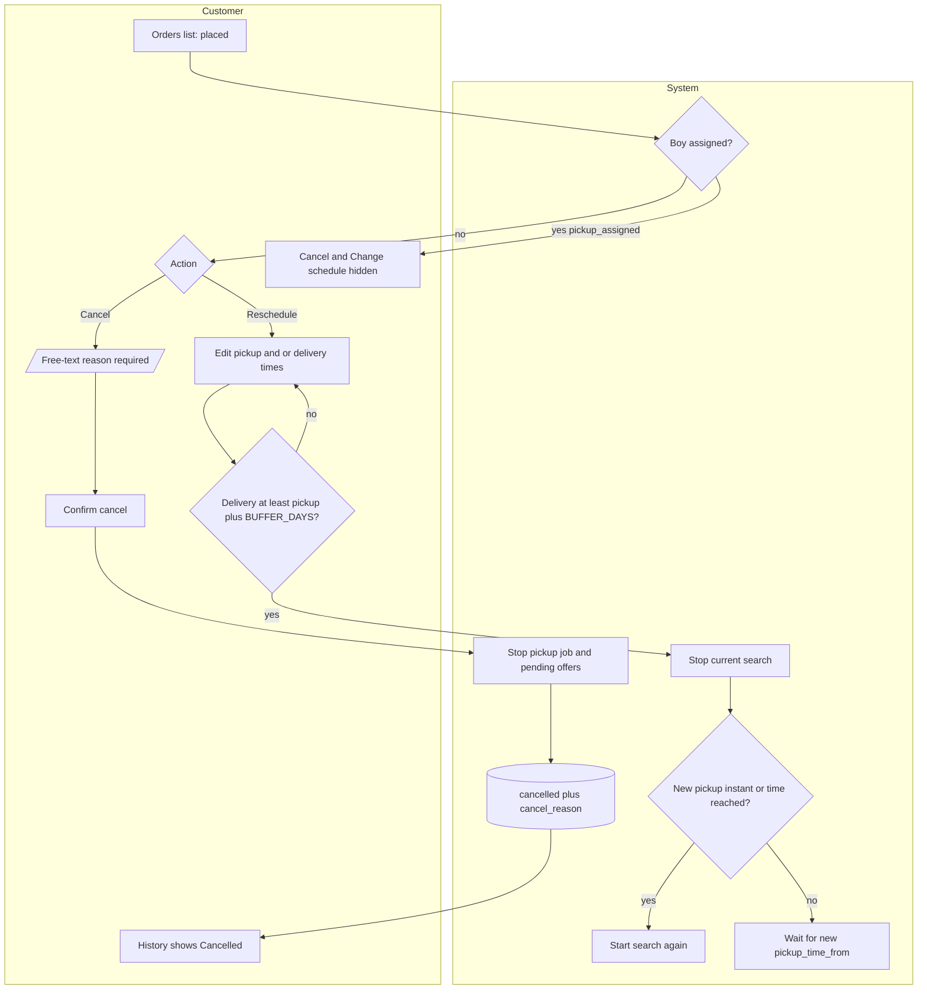

# Swimlane flows

> Part of the order-flow v2 pack. Source of truth: [`../order-flow-spec.md`](../order-flow-spec.md). Mermaid renders in GitHub / Cursor preview.

## 3. Swimlane flows (who does what, in order)

### 3.1 Booking → pickup search → door count → CM handoff

### 3.2 Plant: CM → service men → DM lists

### 3.3 Drop search → out for delivery → payment → delivered

### 3.4 Cancel and reschedule (only while `placed`)

