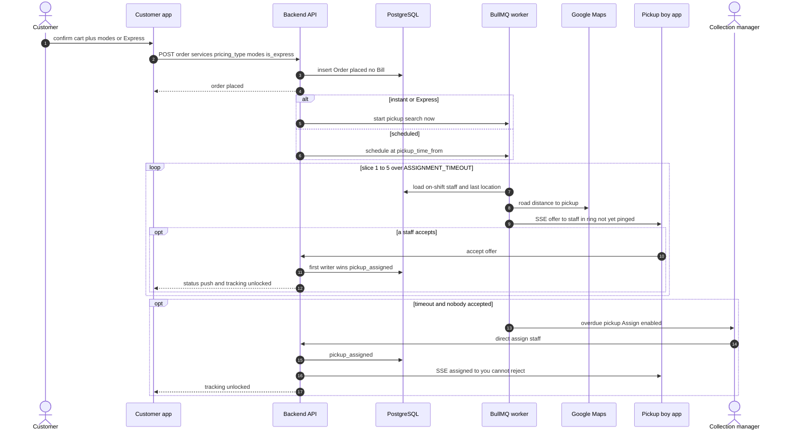
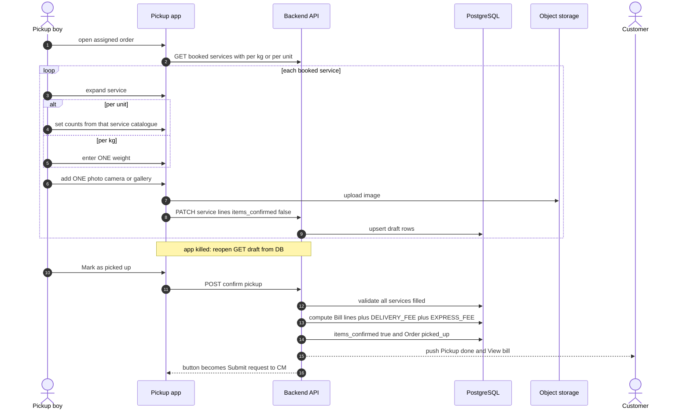
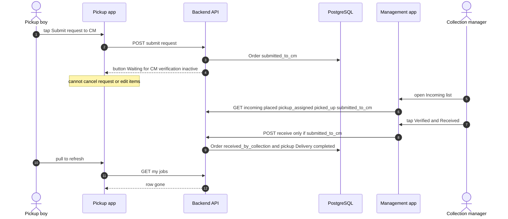
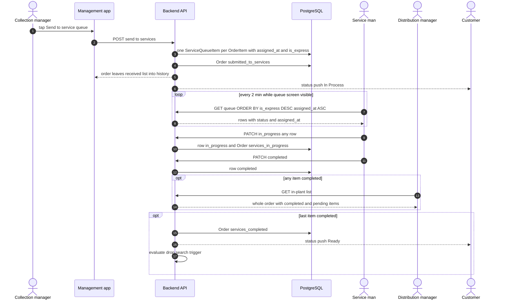
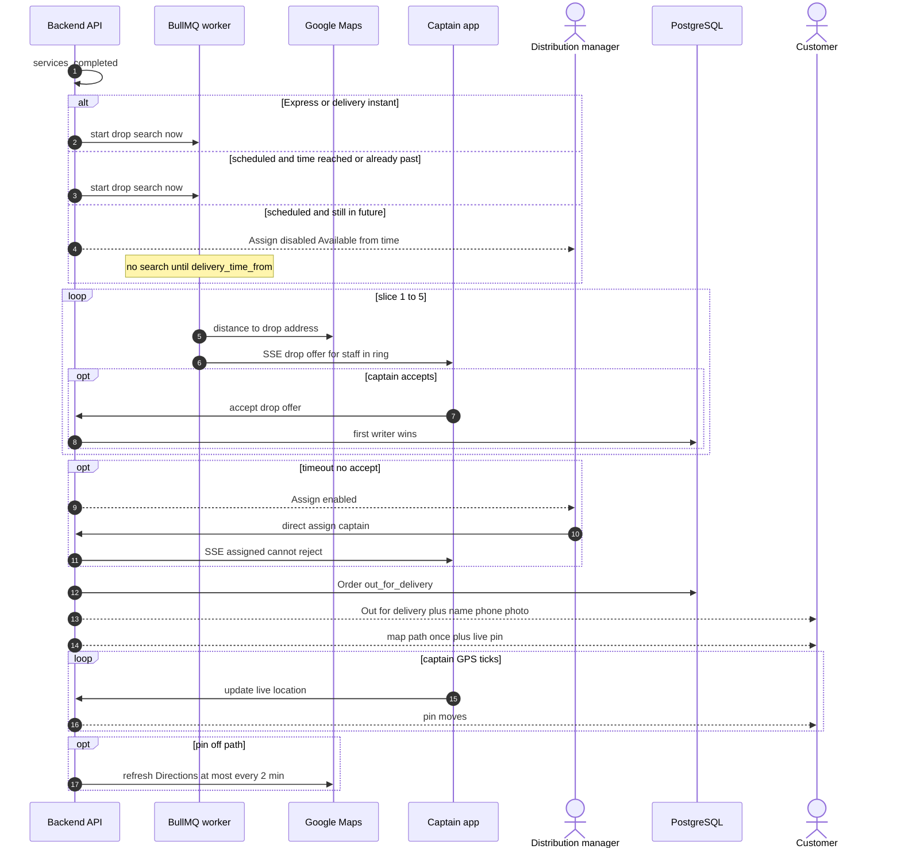
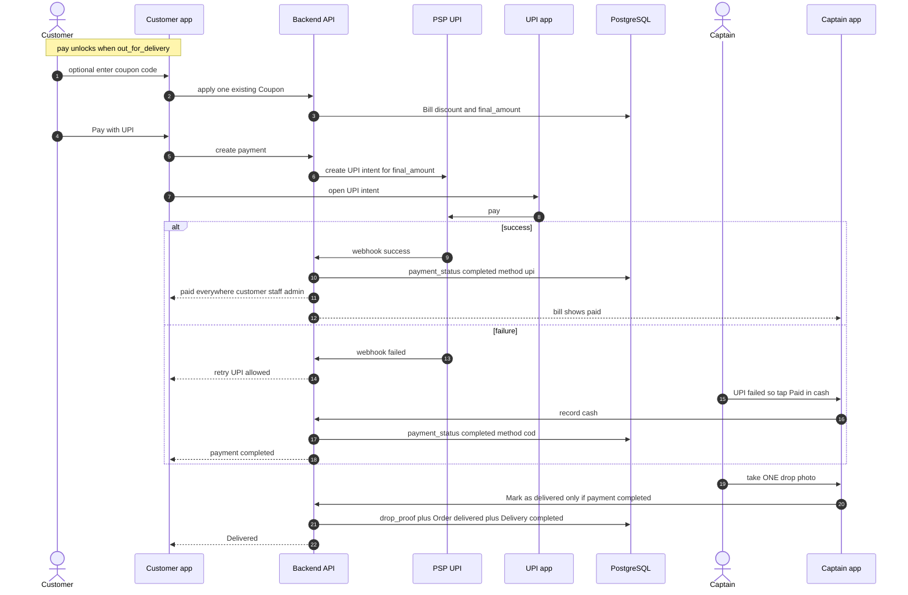
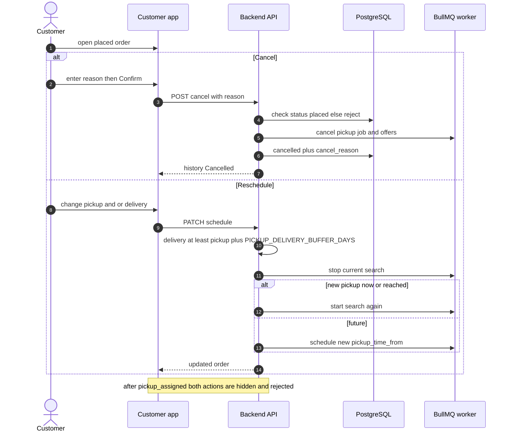

# Sequence diagrams

> Part of the order-flow v2 pack. Source of truth: [`../order-flow-spec.md`](../order-flow-spec.md). Mermaid renders in GitHub / Cursor preview.

## 4. UML sequence diagrams (messages and side effects)

### 4.1 Place order and pickup assignment

### 4.2 Door count, draft, bill

### 4.3 Submit request to CM and Verified and Received

### 4.4 Plant queue

### 4.5 Drop assignment

### 4.6 Payment and delivered

### 4.7 Cancel and reschedule

