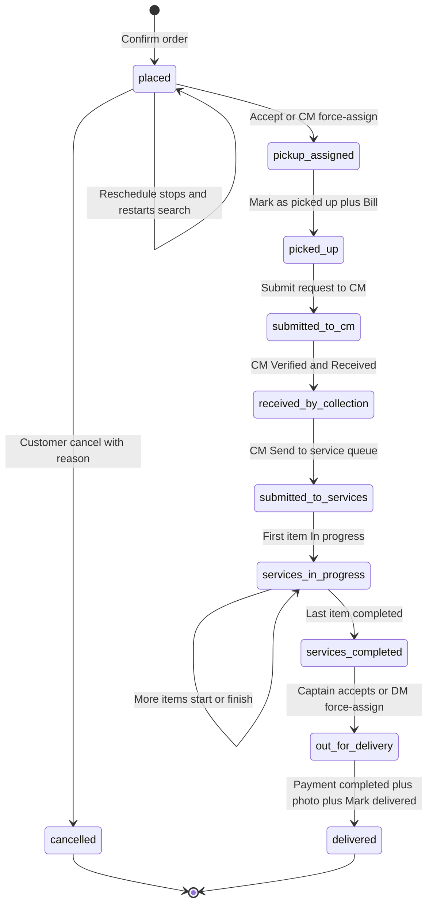
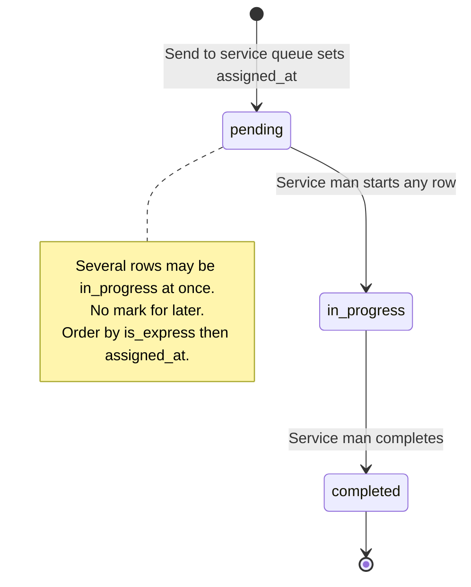
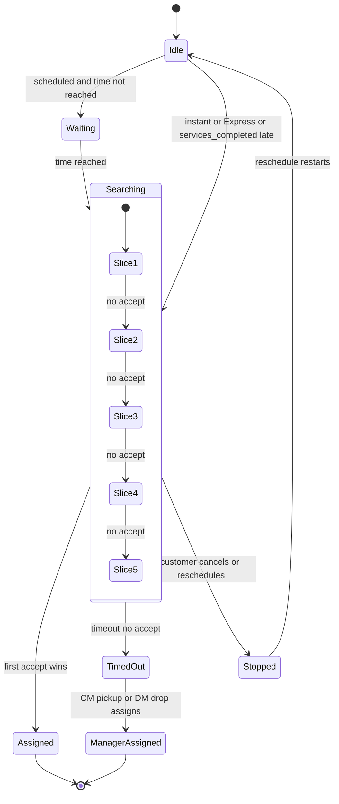
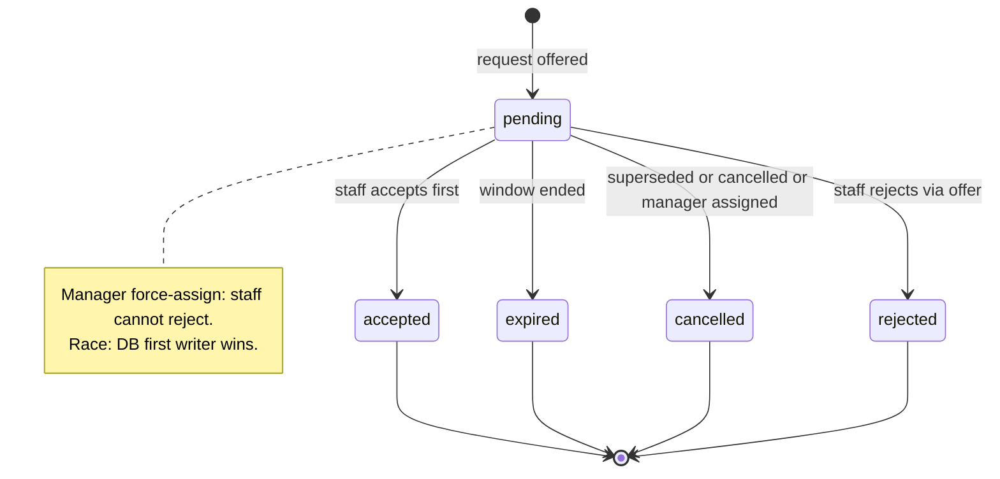
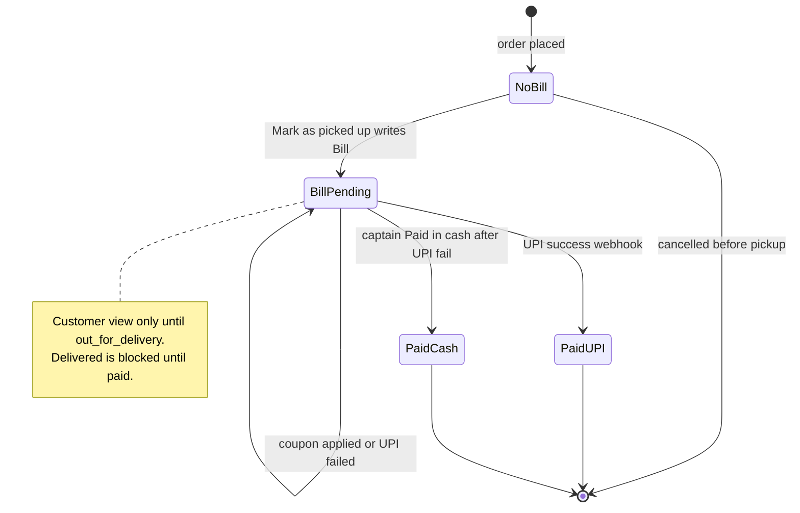
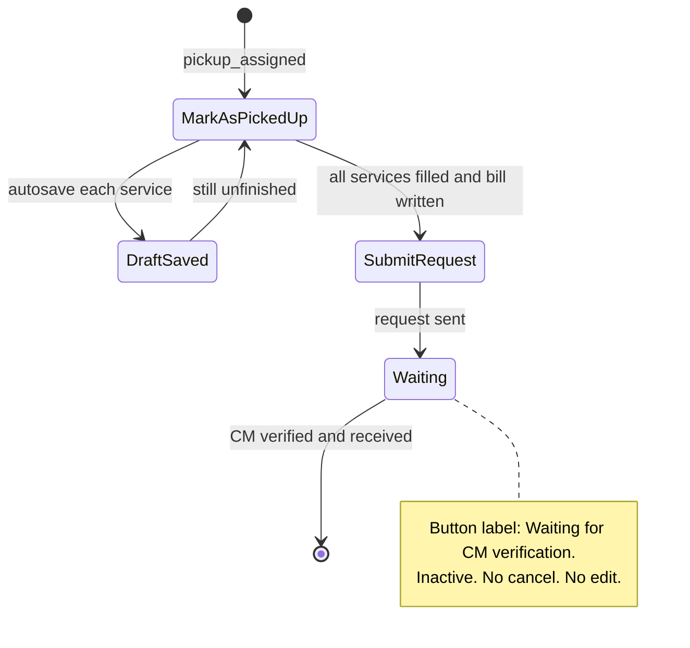
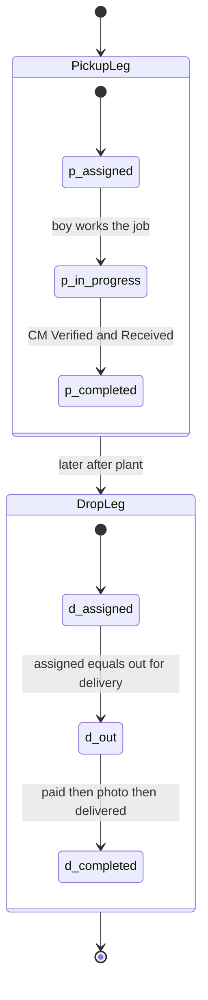

# State machines

> Part of the order-flow v2 pack. Source of truth: [`../order-flow-spec.md`](../order-flow-spec.md). Mermaid renders in GitHub / Cursor preview.

## 5. UML state diagrams

### 5.1 Order status (customer-visible lifecycle)

> Not used on the new path: `dispatch_assigned`, `payment_pending`, `closed` (enum values exist; spec never sets them).

### 5.2 Service queue item

### 5.3 Pickup search / drop search engine

### 5.4 Assignment request and recipient (today enums)

### 5.5 Bill and payment

### 5.6 Pickup boy one button

### 5.7 Delivery leg row

