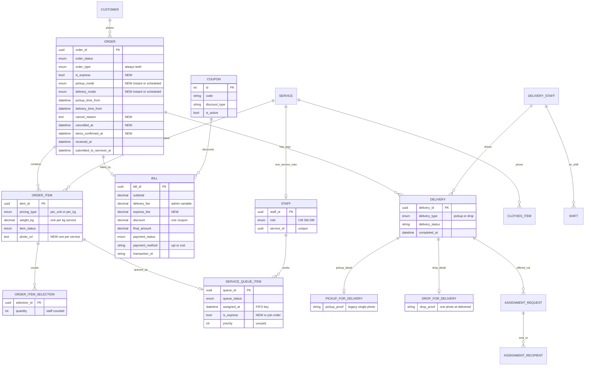

# Data model

> Part of the order-flow v2 pack. Source of truth: [`../order-flow-spec.md`](../order-flow-spec.md). Mermaid renders in GitHub / Cursor preview.

## 6. Data model (existing tables + proposed fields)

