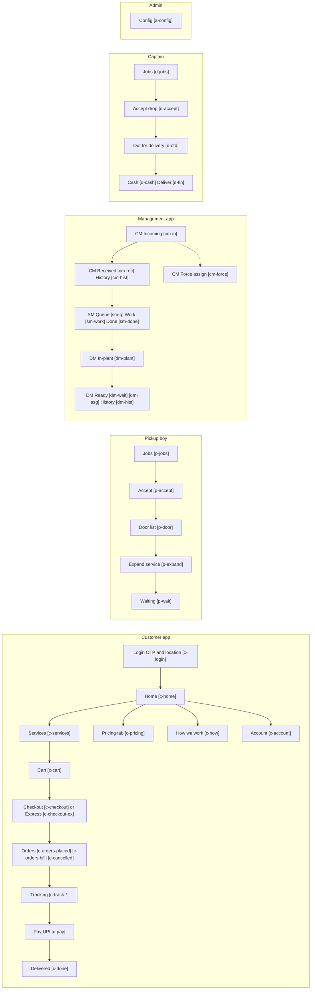

# Screen map and spec vs code

> Part of the order-flow v2 pack. Source of truth: [`../order-flow-spec.md`](../order-flow-spec.md). Mermaid renders in GitHub / Cursor preview.

## 11. Screen map (what each app has)

Click-through phone prototypes: ../ui-prototype/index.html (use **Gallery** to see every screen at once). Screen ids in brackets are the prototype articles.

## 12. Spec vs code today (what changes in dev)

| Area | Today | Needs |
|---|---|---|
| Booking | Cloth SKUs required for per unit; order_type pickup/drop/both | Services only; always both; modes; is_express; no bill at place |
| Assignment | Fixed expiry, send-to-all, 2 retries | Rings, one timeout, on-shift, manager only after timeout, drop twin |
| Door | Weight on existing lines; one proof | Expander per service; one photo each; draft; bill on Mark |
| Submit to CM | One tap completes pickup delivery | Request vs CM receive; delivery completes on receive |
| CM receive guard | From placed/picked_up/etc. | Only submitted_to_cm; remove generate-invoice |
| Plant | priority per service | Sort assigned_at; Express band; drop mark-for-later in UX; poll |
| DM | Verify then dispatch | Two lists; auto drop search; remove verify; Assign disabled states |
| Delivery status | dispatch_assigned → start → out_for_delivery | out_for_delivery on assign |
| Payment | Status PATCH; cod/card/wallet; dropped without pay check | PSP UPI + coupon; cash fallback; gate delivered on paid |
| Cancel | Stub dialog | Real cancel + reason; history |
| Customer UI | 5-step tracker, 4 tabs incl Account | 6 steps, Pricing tab, avatar → Account, How we work, footer |

Related files: `order-flow-spec.md` · `../ui-prototype/index.html`
